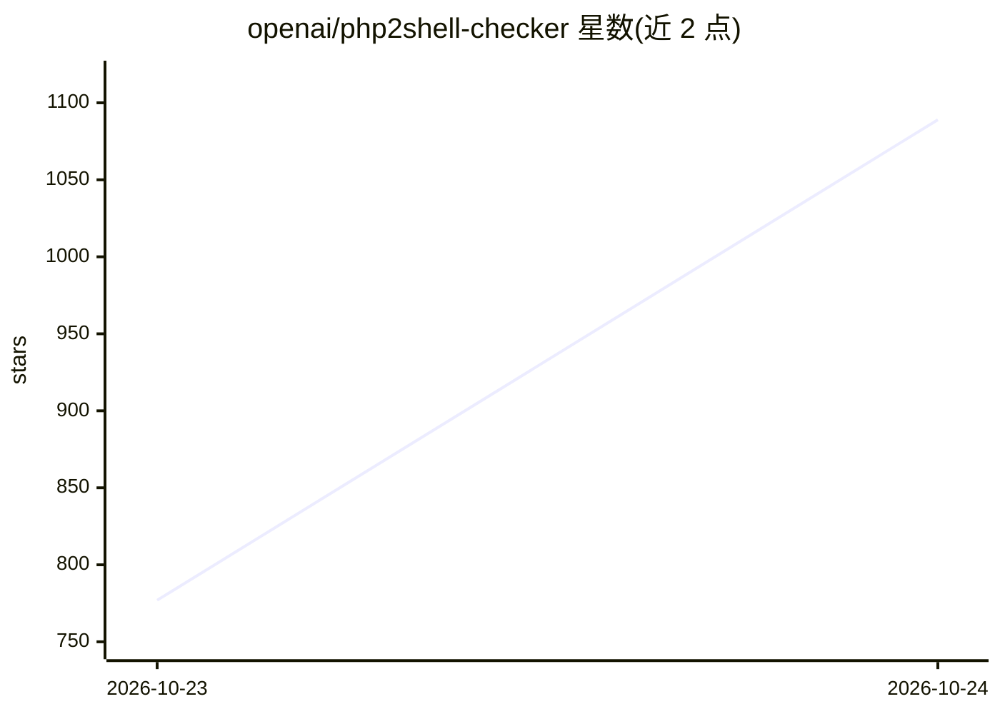

# openai/php2shell-checker

⭐ 1,373 · JavaScript · Apache-2.0 · 推送 2026-10-22 · [GitHub](https://github.com/openai/php2shell-checker) · 组织维护

**检测网站或本地 PHP 是否暴露 php2shell 可利用版本的检查工具**

以 Node.js CLI 与 Codex 技能两种形式提供的 PHP 版本检查器：通过 URL 探测或本地 php -v 读取版本号，与内嵌的各分支截止补丁版本比较，输出 OK/VULNERABLE/UNKNOWN 三态结果与对应退出码，支持 --json 机器可读输出。URL 模式读取 X-Powered-By 与 Server 头，HEAD 失败回退 GET，不跟随重定向、不检查响应体；不独立验证安全修复，UNKNOWN 不代表已修补。面向有服务器访问或仅持 URL 的运维/开发人员。

## 筛选速览

| 维度 | 判定 | 备注 |
|---|---|---|
| AI 角色 | `ai-ecosystem` | LLM/agent 周边工具 |
| 许可风险 | `permissive` | Apache-2.0 |
| 部署形态 | `None` |  |
| 模型依赖 | — | README 未给出锁定关系 |
| 硬件要求 | — | 无带数字的原话,不猜 |
| 安装摩擦 | `low` | 无编译、无系统依赖或容器化 |
| 成熟度 | — | 结构信号不足 |

## 能力要点

- URL 探测与本地 php -v 两种检查模式
- OK/VULNERABLE/UNKNOWN 三态结果与退出码约定
- 支持 --json 机器可读输出
- 可通过 Codex 技能安装器安装（phpcheck-url / phpcheck-server）

## 适用场景

- 检查我的网站 PHP 版本是否暴露于 php2shell 漏洞
- 在服务器上核对本地 CLI PHP 版本状态
- 将检查结果接入 CI 或脚本做自动化判定

## 场景标签

`网络安全` · 领域:学习与行业

## 证据(README 行号)

> L5: To install both skills, ask Codex:
> L8: $skill-installer install both skills from https://github.com/openai/php2shell-checker

## 星数曲线

2026-10-23 777 → 2026-10-24 1,089（+312）

---
*卡片 v1 · prompt 1.4 · 生成 2026-10-22 · 置信度 mid · 依据 README sha `d8f8e411430e` · [字段定义](../../DATASET.md)*
