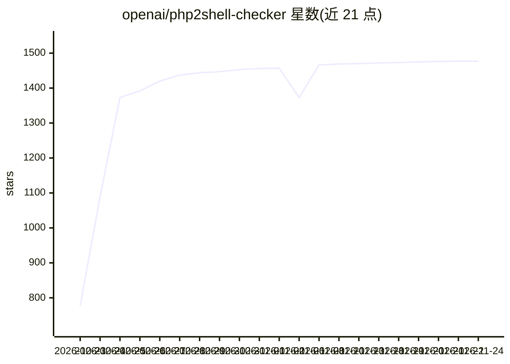

# openai/php2shell-checker

⭐ 1,477 · JavaScript · Apache-2.0 · 推送 2026-10-22 · [GitHub](https://github.com/openai/php2shell-checker) · 组织维护

**检测网站/本地 PHP 版本是否存在已知漏洞的检查工具**

提供两种 Codex 技能：phpcheck-url 通过 HTTP 头（X-Powered-By、Server）检测远程网站 PHP 版本，phpcheck-server 检查本地安装；也可直接用 node 运行脚本。输出 OK / POTENTIALLY VULNERABLE / UNKNOWN 三种结果及对应退出码，对照 2025-10-21 PHP 公告中的上游修复版本判定，支持 --json 机器可读输出。仅读取响应头、不跟随重定向、不发送漏洞利用探测，HTTP 头无法确认是否包含回移植修复。

## 筛选速览

| 维度 | 判定 | 备注 |
|---|---|---|
| AI 角色 | `ai-enhanced` | 去掉 AI 部分产品仍成立 |
| 许可风险 | `permissive` | Apache-2.0 |
| 部署形态 | `None` |  |
| 模型依赖 | — | README 未给出锁定关系 |
| 硬件要求 | — | 无带数字的原话,不猜 |
| 安装摩擦 | `low` | 无编译、无系统依赖或容器化 |
| 成熟度 | — | 结构信号不足 |

## 能力要点

- URL 模式与服务器模式两种检测途径
- 三种结果分级并返回退出码，支持 --json 输出
- 不发送漏洞利用探测、不跟随重定向
- 同时以 Codex 技能与独立 node 脚本形式提供

## 适用场景

- 检查自己网站服务器暴露的 PHP 版本是否在受影响范围
- 在本地安装环境中核验 PHP 版本是否达到上游修复版本
- 在 CI 或脚本中用退出码与 JSON 输出做自动化检查

## 场景标签

`网络安全` · 领域:学习与行业

## 证据(README 行号)

> L3: Get a version-based PHP2Shell warning from a website's PHP headers or local installation.
> L11: Use phpcheck-server when you have server
> L27: node phpcheck.js "https://example.com"

## 星数曲线

2026-10-23 777 → 2026-11-24 1,477（+700）

---
*卡片 v1 · prompt 1.4 · 生成 2026-11-24 · 置信度 high · 依据 README sha `bfd237dbe5f1` · [字段定义](../../DATASET.md)*
