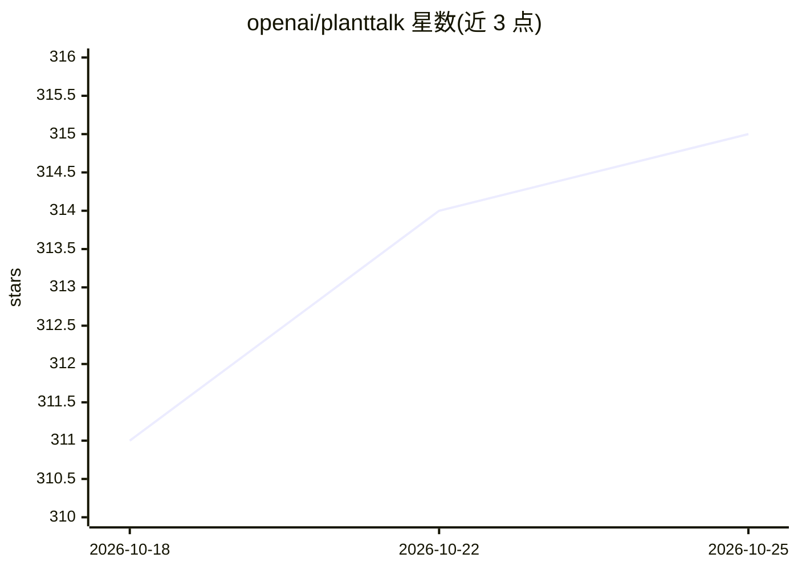

# openai/planttalk

⭐ 315 · TypeScript · Apache-2.0 · 推送 2026-06-30 · [GitHub](https://github.com/openai/planttalk) · 组织维护

**可对话的盆栽项目：用 ChatGPT 让植物开口说话**

OpenAI 发布的 DIY 硬件项目：通过电脑摄像头与麦克风结合 OpenAI API，让室内盆栽以语音对话形式与用户交流，可查看植物状态、总结近期观测并讨论养护需求。构建流程由 Codex Desktop 引导完成。基础版仅需电脑即可运行（仅靠摄像头判断，精度较低）；进阶版通过 Arduino 微控制器接入土壤湿度与光照传感器获取实时数据。用户可自定义植物名称、性格、语音与观测重点。

## 筛选速览

| 维度 | 判定 | 备注 |
|---|---|---|
| AI 角色 | `ai-native` | 本体是模型或模型工具 |
| 许可风险 | `permissive` | Apache-2.0 |
| 部署形态 | `None` |  |
| 模型依赖 | — | README 未给出锁定关系 |
| 硬件要求 | — | 无带数字的原话,不猜 |
| 安装摩擦 | `low` | 无编译、无系统依赖或容器化 |
| 成熟度 | — | 结构信号不足 |

## 能力要点

- 摄像头+麦克风的植物语音对话（Realtime 语音会话）
- 可选 Arduino 接入土壤湿度与光照传感器（USB 串口读取）
- 由 Codex Desktop 引导的逐步构建流程
- 支持自定义名称、性格、语音与观测重点

## 适用场景

- 给家里盆栽装上能对话的语音界面
- 教室演示或艺术项目中的可编程植物接口
- 长期记录并讨论植物健康状态

## 场景标签

`语音 Agent` · 领域:对话与助手

## 证据(README 行号)

> L3: Plant Talk is a houseplant you can have a conversation with using ChatGPT.
> L74: - **Talk to plant:** starts the Realtime voice conversation.

## 星数曲线

2026-10-18 311 → 2026-10-25 315（+4）

---
*卡片 v1 · prompt 1.4 · 生成 2026-10-21 · 置信度 mid · 依据 README sha `b26b16b5ce8c` · [字段定义](../../DATASET.md)*
