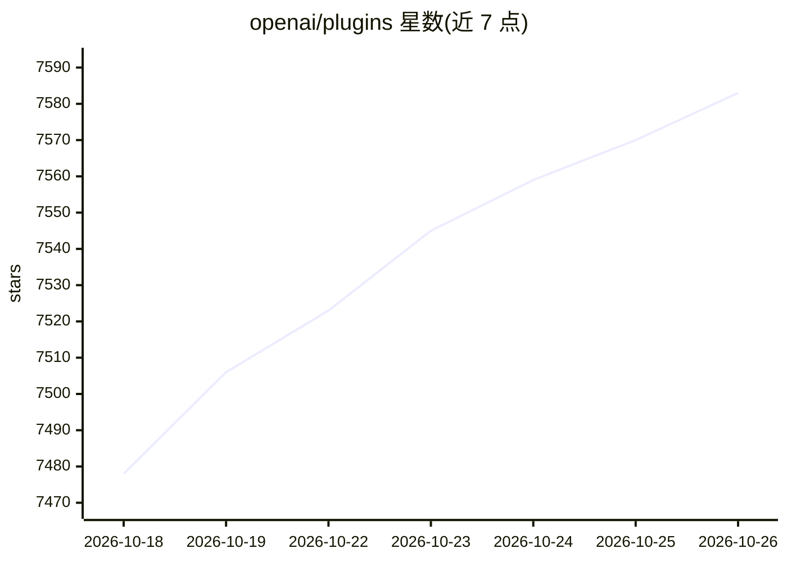

# openai/plugins

⭐ 7,583 · JavaScript · 推送 2026-10-08 · [GitHub](https://github.com/openai/plugins) · 组织维护

**Codex 插件示例的策展仓库，供插件开发者参考**

OpenAI 维护的 Codex 插件示例集合：每个插件位于 plugins/<name>/ 目录，含必需的 .codex-plugin/plugin.json 清单，可选配套 skills/、.mcp.json、agents/、commands/、hooks.json 等文件。仓库内含默认 marketplace.json 与面向 API key 登录用户的独立市场文件。收录示例覆盖 Figma、Notion、iOS/macOS/Web 应用构建、Expo、Netlify、Remotion、Google Slides 等场景的技能与 MCP 支持的插件包。给插件开发者与 Codex 用户提供现成插件与结构参照。

## 筛选速览

| 维度 | 判定 | 备注 |
|---|---|---|
| AI 角色 | `ai-knowledge` | 知识聚合/清单类 |
| 许可风险 | `none` | — |
| 部署形态 | `None` |  |
| 模型依赖 | — | README 未给出锁定关系 |
| 硬件要求 | — | 无带数字的原话,不猜 |
| 安装摩擦 | `low` | 无编译、无系统依赖或容器化 |
| 成熟度 | — | 结构信号不足 |

## 能力要点

- 标准化插件结构：plugin.json 清单加 skills/MCP/agents/commands 等配套面
- 默认市场与 API key 用户市场两套 marketplace.json
- 含 Figma、Notion、iOS/macOS/Web、Expo 等多领域示例插件

## 适用场景

- 查找可直接安装使用的 Codex 插件
- 参照示例开发自己的 Codex 插件
- 了解 Codex 插件的清单与市场机制

## 场景标签

`精选清单` · 领域:学习与行业

## 证据(README 行号)

> L3: This repository contains a curated collection of Codex plugin examples.
> L5: Each plugin lives under `plugins/<name>/` with a required

## 星数曲线

2026-10-18 7,478 → 2026-10-26 7,583（+105）

---
*卡片 v1 · prompt 1.4 · 生成 2026-10-20 · 置信度 high · 依据 README sha `8e044b2adb57` · [字段定义](../../DATASET.md)*
