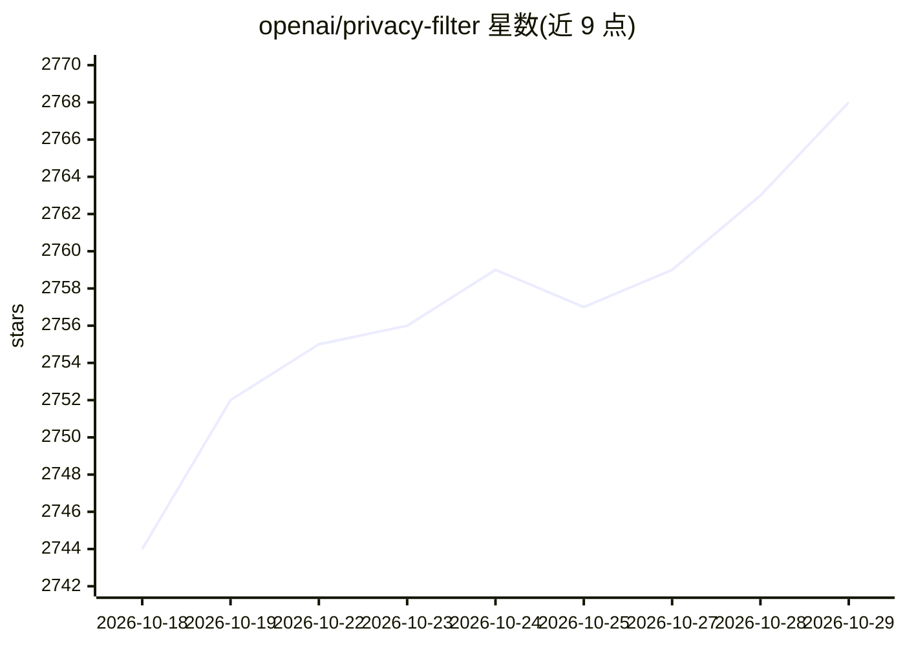

# openai/privacy-filter

⭐ 2,768 · Python · Apache-2.0 · 推送 2026-04-22 · [GitHub](https://github.com/openai/privacy-filter) · 组织维护

**本地运行的 PII 检测与脱敏模型（1.5B，Apache 2.0）**

OpenAI 发布的双向 token 分类模型，用于检测并遮蔽文本中的个人身份信息（PII）。模型由自回归预训练检查点转换为 token 分类头，单次前向标注全部 token，再经约束 Viterbi 解码生成连贯 BIOES 片段，支持 128K 上下文与运行时精度/召回权衡调节。仓库提供 CLI（redact/eval/train 三模式）、Python API 与本地微调代码，面向需在自有环境运行的数据清洗团队。模型主要面向英文，标签策略固定，改策略需微调。

## 筛选速览

| 维度 | 判定 | 备注 |
|---|---|---|
| AI 角色 | `ai-native` | 本体是模型或模型工具 |
| 许可风险 | `permissive` | Apache-2.0 |
| 部署形态 | `library` | 以包/库形式分发 |
| 模型依赖 | — | README 未给出锁定关系 |
| 硬件要求 | — | 无带数字的原话,不猜 |
| 安装摩擦 | `low` | 无编译、无系统依赖或容器化 |
| 成熟度 | — | 结构信号不足 |

## 能力要点

- 检测 8 类隐私片段（账号、地址、邮箱、人名、电话、URL、日期、密钥）
- 1.5B 参数、50M 激活参数，可在浏览器或笔记本运行
- 128K token 上下文，单次前向完成全部标注
- 提供 CLI 一键脱敏、评测与本地微调（opf train）

## 适用场景

- 高吞吐数据清洗流水线中对文本做本地 PII 脱敏
- 在自有标注数据上微调以适配特定标签策略
- 在带标注数据集上评估脱敏精度与召回

## 场景标签

 · 领域:隐私/数据安全 NLP

## 证据(README 行号)

> L3: OpenAI Privacy Filter is a bidirectional token-classification model for personally identifiable information (PII) de
> L5: OpenAI Privacy Filter is pretrained autoregressively to arrive at a checkpoint with similar architecture to gpt-oss,

## 星数曲线

2026-10-18 2,744 → 2026-10-29 2,768（+24）

---
*卡片 v1 · prompt 1.4 · 生成 2026-10-21 · 置信度 high · 依据 README sha `ecf989faa208` · [字段定义](../../DATASET.md)*
