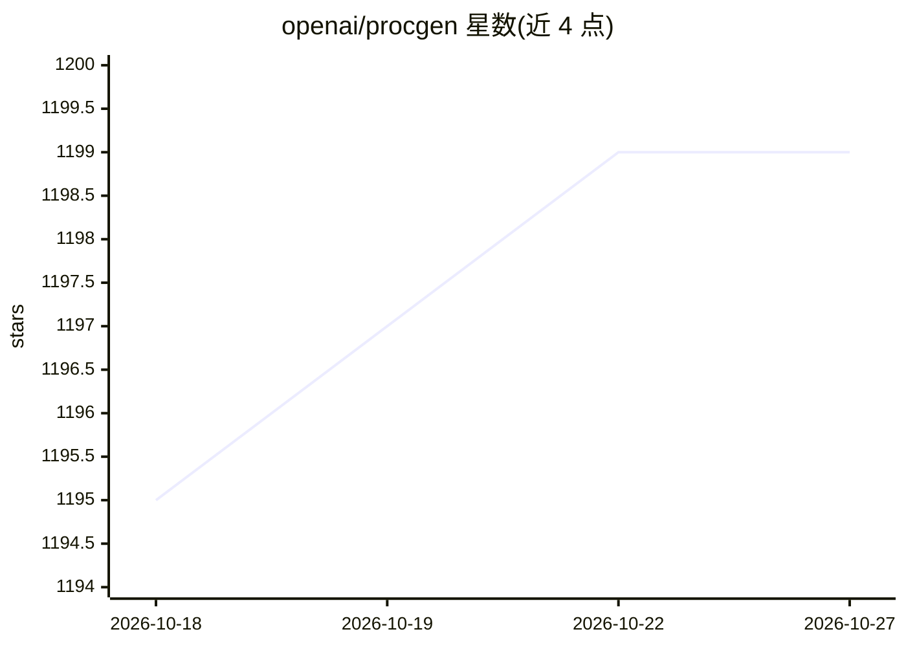

# openai/procgen

⭐ 1,199 · C++ · MIT · 推送 2026-03-27 · [GitHub](https://github.com/openai/procgen) · [官网](https://openai.com/blog/procgen-benchmark/) · 组织维护

**16 个程序化生成的强化学习评测环境，衡量 RL 智能体泛化能力**

OpenAI 维护的 Procgen Benchmark：提供 16 个程序化生成的 Gym 游戏环境（coinrun、maze、starpilot 等），随机化关卡使智能体无法靠死记序列刷分，用于度量强化学习智能体的样本效率与泛化技能习得速度。单核每秒可执行数千步，与关联论文配套，曾支撑 2020 年 RL 竞赛。环境提供 gym 与 gym3 向量化两种接口，附带 Dockerfile 演示最小部署；当前处于维护模式（仅修复 bug 与小更新），支持 Python 3.7-3.10（64 位），CPU 需支持 AVX 指令集。

## 筛选速览

| 维度 | 判定 | 备注 |
|---|---|---|
| AI 角色 | `ai-ecosystem` | LLM/agent 周边工具 |
| 许可风险 | `permissive` | MIT |
| 部署形态 | `self-host` | docker 或自建部署 |
| 模型依赖 | — | README 未给出锁定关系 |
| 硬件要求 | — | 无带数字的原话,不猜 |
| 安装摩擦 | `low` | 无编译、无系统依赖或容器化 |
| 成熟度 | — | 结构信号不足 |

## 能力要点

- 16 个随机化关卡的游戏环境，关卡由程序生成不可记忆
- 单核运行速度达每秒数千步
- 同时提供 gym 与 gym3 向量化环境接口
- 附 Docker 最小部署示例与源码构建示例

## 适用场景

- 评测强化学习算法的样本效率与泛化能力
- 在固定基准上对比不同 RL 智能体的学习速度
- 从源码安装后自定义或自建环境变体做实验

## 场景标签

`强化学习` `模型评测` · 领域:评测与运维

## 证据(README 行号)

> L7: 16 simple-to-use procedurally-generated gym environments which provide a direct measure of how quickly a reinforceme
> L11: These environments are associated with the paper Leveraging Procedural Generation to Benchmark Reinforcement Learni

## 星数曲线

2026-10-18 1,195 → 2026-10-27 1,199（+4）

---
*卡片 v1 · prompt 1.4 · 生成 2026-10-21 · 置信度 high · 依据 README sha `442bcd8e0ec4` · [字段定义](../../DATASET.md)*
