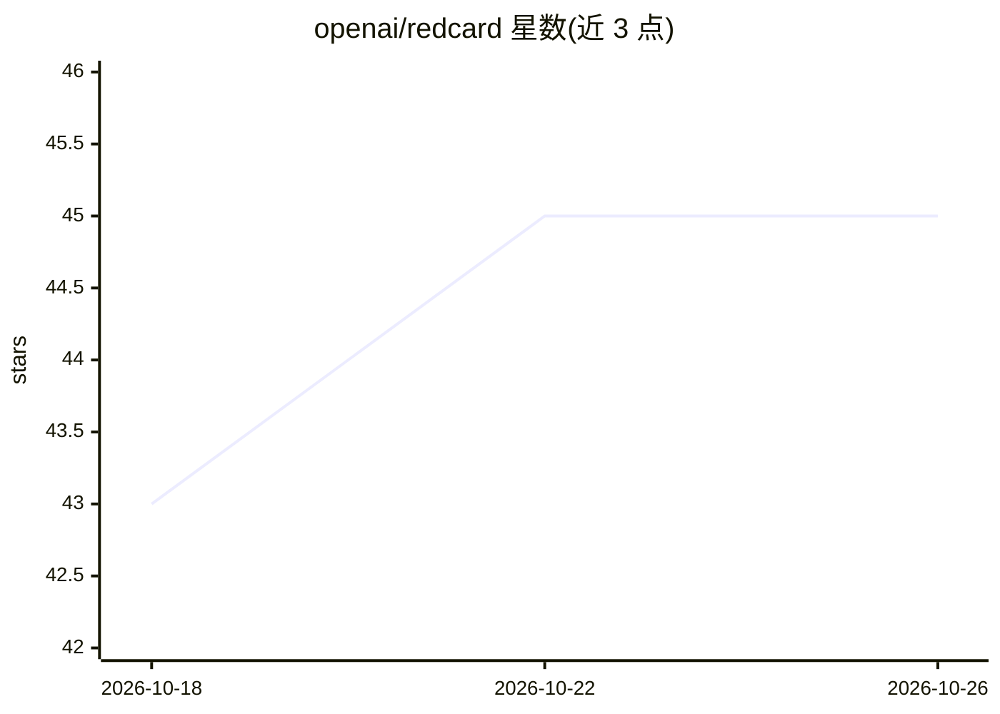

# openai/redcard

⭐ 45 · Python · Apache-2.0 · 推送 2026-07-14 · [GitHub](https://github.com/openai/redcard) · 组织维护

**举起红牌即自动退出工作的 Codex 摄像头技能**

面向 macOS + ChatGPT/Codex 用户的趣味自动化技能：通过摄像头识别举起红色卡片，触发发送告别消息、退出 Google Meet 通话、日历屏蔽时间、开启休假自动回复并播放裁判动画。无需编程知识，由 Codex 引导完成安装、原生辅助程序构建与权限检查，可按自然语言修改告别语、灵敏度等。依赖 Python 3.11+、Xcode 命令行工具与摄像头权限。

## 筛选速览

| 维度 | 判定 | 备注 |
|---|---|---|
| AI 角色 | `ai-native` | 本体是模型或模型工具 |
| 许可风险 | `permissive` | Apache-2.0 |
| 部署形态 | `None` |  |
| 模型依赖 | — | README 未给出锁定关系 |
| 硬件要求 | — | 无带数字的原话,不猜 |
| 安装摩擦 | `low` | 无编译、无系统依赖或容器化 |
| 成熟度 | — | 结构信号不足 |

## 能力要点

- 摄像头识别红牌触发退出会议、日历屏蔽与休假回复等系列动作
- 通过 Codex 引导式构建，用户无需编程基础
- 可用自然语言定制告别消息、灵敏度与动画
- 全局 Esc 快捷键可随时中止

## 适用场景

- 会议中举红牌让程序替我体面离场并自动安排休假
- 让 Codex 帮我零代码搭建并个性化这个自动化技能

## 场景标签

`目标检测` `工作流自动化` · 领域:效率与自动化

## 证据(README 行号)

> L9: Red Card is a webcam-powered Codex skill that ejects you from work, and you can
> L12: Hold up a red card and the app sends your goodbye, leaves the call, blocks time
> L14: animation. You do not need to know how to code—Codex walks you through setup

## 星数曲线

2026-10-18 43 → 2026-10-26 45（+2）

---
*卡片 v1 · prompt 1.4 · 生成 2026-10-25 · 置信度 high · 依据 README sha `87ab70dca8c5` · [字段定义](../../DATASET.md)*
