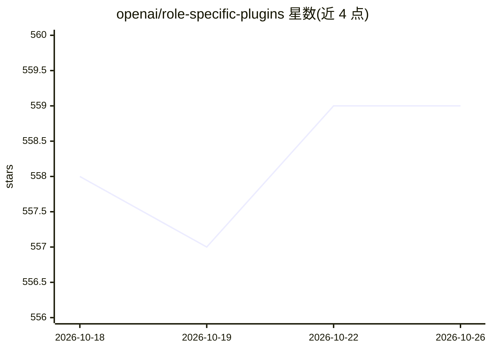

# openai/role-specific-plugins

⭐ 559 · 推送 2026-09-30 · [GitHub](https://github.com/openai/role-specific-plugins) · 组织维护

**面向 Codex 的角色专用插件模板仓库（占位）**

openai 名下的 Role-Specific Plugins 仓库，README 仅说明这是即将推出的角色专用 Codex 插件模板的占位页面，未提供功能描述、安装说明或插件清单。按仓库定位，它面向为 Codex 开发角色化插件模板的开发者。当前内容为占位说明，无可用代码或文档细节。

## 筛选速览

| 维度 | 判定 | 备注 |
|---|---|---|
| AI 角色 | `ai-ecosystem` | LLM/agent 周边工具 |
| 许可风险 | `none` | — |
| 部署形态 | `None` |  |
| 模型依赖 | — | README 未给出锁定关系 |
| 硬件要求 | — | 无带数字的原话,不猜 |
| 安装摩擦 | `low` | 无编译、无系统依赖或容器化 |
| 成熟度 | — | 结构信号不足 |

## 能力要点

- README 仅为即将推出的角色专用 Codex 插件模板的占位说明
- 由 openai 组织维护

## 适用场景

- 关注 Codex 角色专用插件模板的后续发布

## 场景标签

 · 领域:开发者工具/插件模板

## 证据(README 行号)

> L1: # Role-Specific Plugins
> L3: Placeholder for upcoming role-specific plugins.

## 星数曲线

2026-10-18 558 → 2026-10-26 559（+1）

---
*卡片 v1 · prompt 1.4 · 生成 2026-10-21 · 置信度 low · 依据 README sha `ca1606e0a87b` · [字段定义](../../DATASET.md)*
