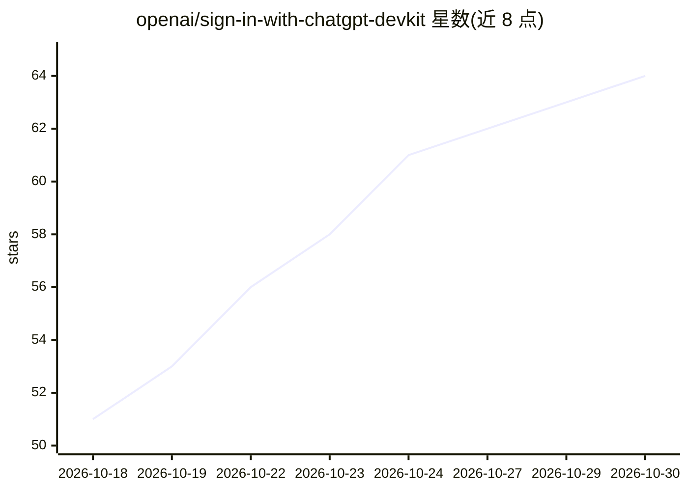

# openai/sign-in-with-chatgpt-devkit

⭐ 64 · TypeScript · NOASSERTION · 推送 2026-10-07 · [GitHub](https://github.com/openai/sign-in-with-chatgpt-devkit) · 组织维护

**让用户用 ChatGPT 账号登录本地开源应用的集成开发包**

OpenAI 提供的 Sign in with ChatGPT 开发套件：包含本地 Node.js SDK（OAuth、凭据存储、账号档案、模型发现、流式 Responses）、可复用 React 组件、设计资源与组件示例库；另附 Paste Perfect 示例应用，在 macOS 上用 ChatGPT 账号登录后对复制文本做转换并粘贴到其他应用。用户可在授权后用 ChatGPT 计划驱动应用 AI 功能，无需配置 API key。代码采用非商业许可证 v1.0。

## 筛选速览

| 维度 | 判定 | 备注 |
|---|---|---|
| AI 角色 | `ai-ecosystem` | LLM/agent 周边工具 |
| 许可风险 | `none` | NOASSERTION |
| 部署形态 | `None` |  |
| 模型依赖 | — | README 未给出锁定关系 |
| 硬件要求 | — | 无带数字的原话,不猜 |
| 安装摩擦 | `low` | 无编译、无系统依赖或容器化 |
| 成熟度 | — | 结构信号不足 |

## 能力要点

- 本地 Node.js SDK @siwc/local：OAuth、凭据存储、模型发现与流式 Responses
- @siwc/react 登录/连接状态/计划用量 UI 组件与设计资源
- Paste Perfect 示例 macOS 应用（文本转换粘贴，Electron 设置面板）
- 示例含 OS 加密凭据存储的接入方法

## 适用场景

- 为本地运行的开源应用接入 ChatGPT 账号登录
- 让用户以自己的 ChatGPT 计划驱动应用 AI 功能，免去 API key 配置
- 参照 Paste Perfect 学习 SDK 与 React 组件的完整接线

## 场景标签

 · 领域:开发工具/身份认证

## 证据(README 行号)

> L8: This DevKit is for developers building open-source apps that run on a user's own machine. It gives you a local Node.
> L16: Use `@siwc/local` in your app's local Node.js process for sign-in and API requests, and `@siwc/react` for the UI. I

## 星数曲线

2026-10-18 51 → 2026-10-30 64（+13）

---
*卡片 v1 · prompt 1.4 · 生成 2026-10-24 · 置信度 high · 依据 README sha `f3bb37cc8bf3` · [字段定义](../../DATASET.md)*
