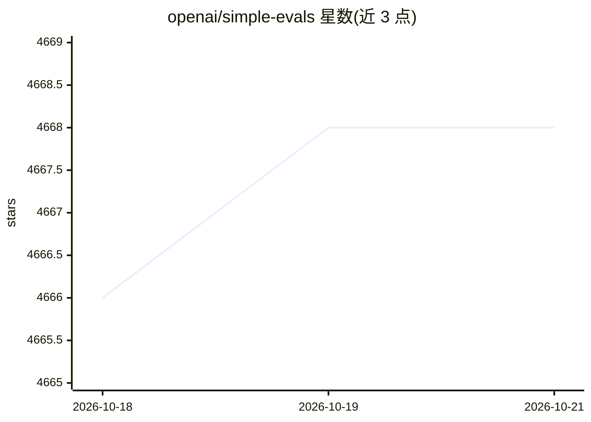

# openai/simple-evals

⭐ 4,668 · Python · MIT · 推送 2026-04-22 · [GitHub](https://github.com/openai/simple-evals) · 组织维护

**OpenAI 的轻量级语言模型评测库：跑 MMLU/MATH 等基准**

OpenAI 开源的 LLM 评测库，提供 MMLU、MATH、GPQA、DROP、MGSM、HumanEval、SimpleQA、BrowseComp、HealthBench 等基准的参考实现，采用 zero-shot chain-of-thought 设定，并附各模型评测结果表。内置 OpenAI 与 Claude 两类 API 采样接口，需设置 API key，通过 python -m 命令运行。2025 年 7 月声明不再更新新模型与结果，仅继续托管 HealthBench/BrowseComp/SimpleQA 参考实现；不设统一安装机制，按 eval 与 sampler 分别安装依赖；明确不替代 openai/evals。

## 筛选速览

| 维度 | 判定 | 备注 |
|---|---|---|
| AI 角色 | `ai-ecosystem` | LLM/agent 周边工具 |
| 许可风险 | `permissive` | MIT |
| 部署形态 | `library` | 以包/库形式分发 |
| 模型依赖 | locked-api |  |
| 硬件要求 | — | 无带数字的原话,不猜 |
| 安装摩擦 | `low` | 无编译、无系统依赖或容器化 |
| 成熟度 | — | 结构信号不足 |

## 能力要点

- 9 个基准评测的参考实现（MMLU/MATH/GPQA/DROP/MGSM/HumanEval/SimpleQA/BrowseComp/HealthBench）
- OpenAI 与 Claude API 采样接口，zero-shot CoT 评测设定
- python -m simple-evals 命令行列出模型并运行评测
- 随附 OpenAI o 系列与 GPT-4 系列等模型的基准结果表

## 适用场景

- 复现 OpenAI 发表的各模型基准分数
- 以统一 zero-shot CoT 口径评测自选模型
- 了解各基准数据集的来源与许可

## 场景标签

`模型评测` · 领域:评测与运维

## 证据(README 行号)

> L6: This repository contains a lightweight library for evaluating language models.
> L71: ## Evals

## 星数曲线

2026-10-18 4,666 → 2026-10-21 4,668（+2）

---
*卡片 v1 · prompt 1.4 · 生成 2026-10-20 · 置信度 mid · 依据 README sha `c5fad7cadc34` · [字段定义](../../DATASET.md)*
