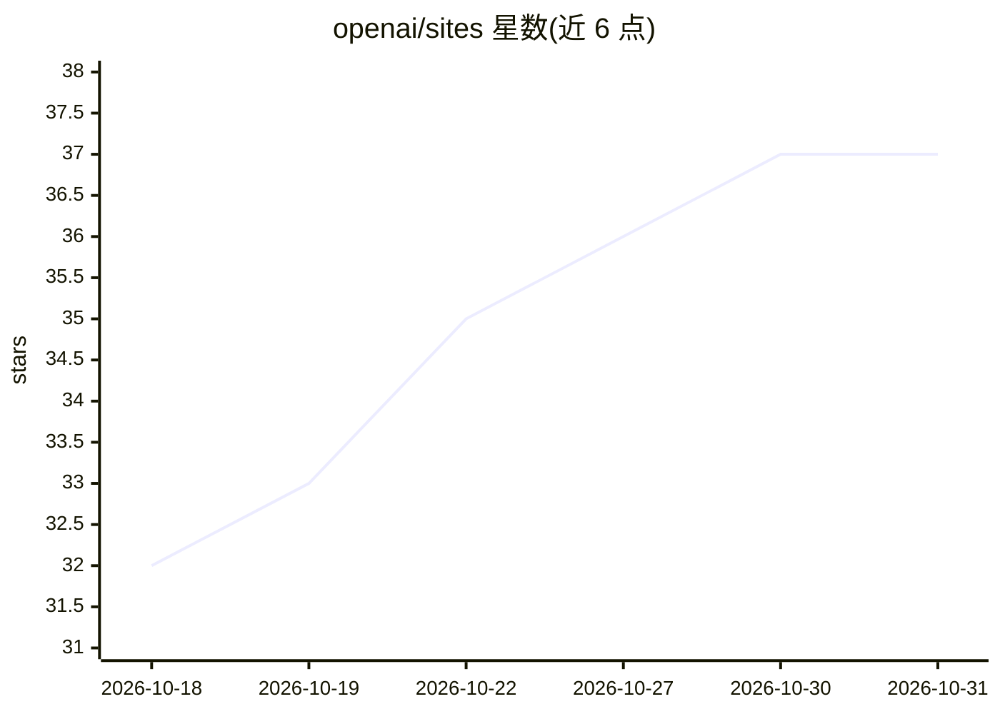

# openai/sites

⭐ 37 · TypeScript · MIT · 推送 2026-10-21 · [GitHub](https://github.com/openai/sites) · 组织维护

**构建与打包 ChatGPT Sites 的 TypeScript 工具集**

OpenAI 官方仓库，提供两个 npm 包：@openai/create-sites 是创建 ChatGPT Sites 项目的 CLI，@openai/sites-vite-plugin 是 Vite 插件，负责打包 OpenAI Sites 部署元数据与 Drizzle 数据库迁移。面向在 OpenAI 托管平台上开发 Sites 的前端开发者，要求 Node.js 22.13+ 与 Vite 8。仓库为 pnpm workspace，通过 ppm install/check/build/test 等命令完成格式化、类型检查、构建与测试。MIT 许可。

## 筛选速览

| 维度 | 判定 | 备注 |
|---|---|---|
| AI 角色 | `ai-ecosystem` | LLM/agent 周边工具 |
| 许可风险 | `permissive` | MIT |
| 部署形态 | `library` | 以包/库形式分发 |
| 模型依赖 | — | README 未给出锁定关系 |
| 硬件要求 | — | 无带数字的原话,不猜 |
| 安装摩擦 | `low` | 无编译、无系统依赖或容器化 |
| 成熟度 | — | 结构信号不足 |

## 能力要点

- create-sites CLI 用于创建 ChatGPT Sites 项目
- Vite 插件打包部署元数据与 Drizzle 迁移
- pnpm workspace，测试针对真实 Vite 构建

## 适用场景

- 初始化一个 ChatGPT Sites 项目
- 在 Vite 构建流程中集成 OpenAI Sites 部署打包

## 场景标签

 · 领域:Web 开发工具/ChatGPT 生态

## 证据(README 行号)

> L5: OpenAI Sites provides JavaScript/TypeScript tooling for building and packaging
> L10: - `@openai/create-sites`: CLI for creating ChatGPT Sites

## 星数曲线

2026-10-18 32 → 2026-10-31 37（+5）

---
*卡片 v1 · prompt 1.4 · 生成 2026-10-25 · 置信度 mid · 依据 README sha `9183244111f6` · [字段定义](../../DATASET.md)*
