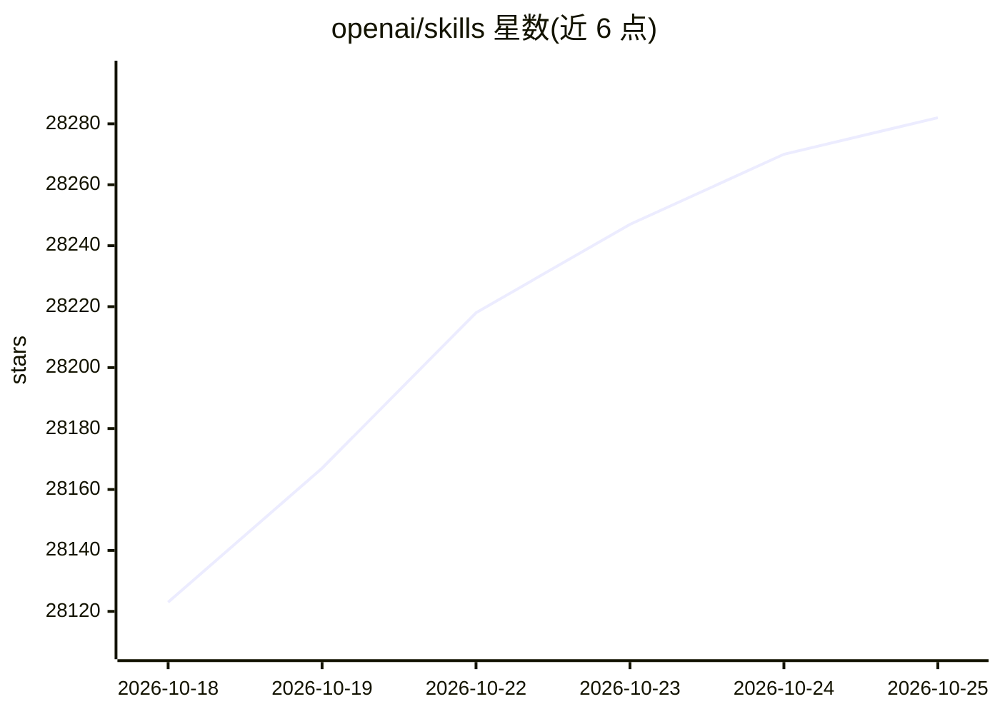

# openai/skills

⭐ 28,300 · Python · 推送 2026-09-08 · [GitHub](https://github.com/openai/skills) · 组织维护

**为 Codex 提供可发现、可复用的 AI agent 技能目录**

OpenAI 维护的 Codex 技能目录仓库：技能是指令、脚本与资源的文件夹，供 AI agent 发现并用于完成特定任务。目录分为 .system（随最新版 Codex 自动安装）、.curated 与 .experimental 三类，通过 Codex 内置的 $skill-installer 按名称、文件夹或 GitHub URL 安装，安装后重启 Codex 生效。各技能的许可单独存放在其目录内的 LICENSE.txt。仓库本身已弃用，官方指向 OpenAI Plugins 仓库与 Build plugins 指南。

## 筛选速览

| 维度 | 判定 | 备注 |
|---|---|---|
| AI 角色 | `ai-native` | 本体是模型或模型工具 |
| 许可风险 | `none` | — |
| 部署形态 | `None` |  |
| 模型依赖 | — | README 未给出锁定关系 |
| 硬件要求 | — | 无带数字的原话,不猜 |
| 安装摩擦 | `low` | 无编译、无系统依赖或容器化 |
| 成熟度 | — | 结构信号不足 |

## 动量与使用信号

- 维护:`active` — 距上次 push 39.5 天,年发版 0,35 位贡献者
- 涨星:近 1 天 **+23**(自 20261016 起算)

## 能力要点

- 技能以指令/脚本/资源文件夹形式打包，一次编写多处使用
- .system 技能随最新版 Codex 自动安装
- 通过 $skill-installer 按名称、文件夹或 GitHub URL 安装技能
- 各技能许可独立存放于目录内 LICENSE.txt

## 适用场景

- 在 Codex 中安装官方策划的技能以复用任务流程
- 编写并分发自定义技能给团队使用
- 通过 GitHub URL 安装实验性技能进行试用

## 场景标签

`精选清单` · 领域:学习与行业

## 证据(README 行号)

> L4: # Agent Skills
> L8: Codex uses skills to help package capabilities that teams and individuals can use to complete specific tasks in a re
> L2: > **This repository is deprecated.** For current Codex skill and plugin examples, use the OpenAI Plugins repository.

## 星数曲线

2026-10-18 28,123 → 2026-10-25 28,282（+159）

---
*卡片 v1 · prompt 1.4 · 生成 2026-10-18 · 置信度 high · 依据 README sha `7c5f54d901ed` · [字段定义](../../DATASET.md)*
