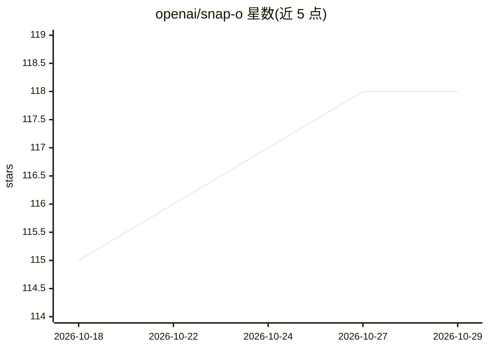

# openai/snap-o

⭐ 118 · Swift · Apache-2.0 · 推送 2026-10-28 · [GitHub](https://github.com/openai/snap-o) · [官网](https://openai.github.io/snap-o/) · 组织维护

**macOS 上的 Android 应用检查与调试工具（截屏/抓包/改值）**

OpenAI 发布的 macOS 桌面应用，面向 Android 开发者：对运行中的 Android 应用截取屏幕截图与录像（无需在应用内集成库）、检查 HTTP/WebSocket 网络流量并用 Python 处理器改写或 mock 响应、以及不重启地实时调整 Compose/Views 中的数值、颜色等参数。Network 与 Tweaks 功能需在 Android 应用中集成对应库；另提供独立 CLI、REST API、Codex skill 与插件扩展模型。要求 macOS 26+ 与 adb，从源码构建需 Xcode 26.4.1+。

## 筛选速览

| 维度 | 判定 | 备注 |
|---|---|---|
| AI 角色 | `ai-enhanced` | 去掉 AI 部分产品仍成立 |
| 许可风险 | `permissive` | Apache-2.0 |
| 部署形态 | `None` |  |
| 模型依赖 | — | README 未给出锁定关系 |
| 硬件要求 | — | 无带数字的原话,不猜 |
| 安装摩擦 | `low` | 无编译、无系统依赖或容器化 |
| 成熟度 | — | 结构信号不足 |

## 能力要点

- 截图/录像无需在 Android 应用内集成库，Capture History 保存 30 天
- 网络检查支持 OkHttp/Ktor/HttpURLConnection，可用 Python 改写或 mock 响应
- Tweaks 不重建不重启即可修改 Compose/Views 数值、颜色等
- 提供 CLI、REST API、Codex skill 与工具插件扩展模型

## 适用场景

- 调试 Android 应用时抓取截图、录像并核对动画逐帧效果
- 检查并 mock 应用的网络请求以测试不同响应
- 开发中实时调整界面参数而无需重新构建应用

## 场景标签

 · 领域:移动开发工具

## 证据(README 行号)

> L5: Snap-O is a handy macOS app for inspecting Android apps. Capture screenshots and recordings, inspect network traffic
> L57: Network and Tweaks each have a standalone CLI and a Codex skill for macOS and Linux. They require Python 3, Android
> L84: Apache 2.0. Copyright 2025 OpenAI.

## 星数曲线

2026-10-18 115 → 2026-10-29 118（+3）

---
*卡片 v1 · prompt 1.4 · 生成 2026-10-23 · 置信度 high · 依据 README sha `ee7586f89ad9` · [字段定义](../../DATASET.md)*
