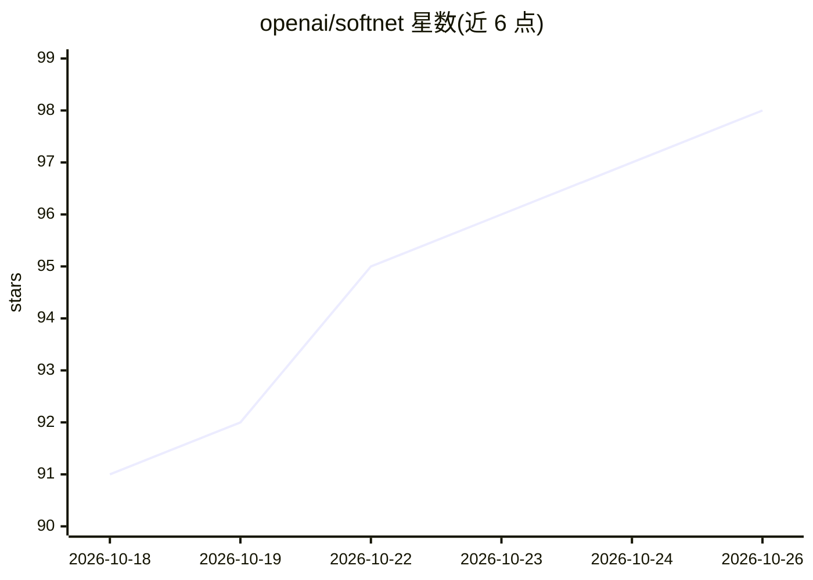

# openai/softnet

⭐ 98 · Rust · NOASSERTION · 推送 2026-10-25 · [GitHub](https://github.com/openai/softnet) · 组织维护

**macOS 虚拟机网络隔离与 DHCP 缓解工具（Tart 配套）**

面向 Tart 虚拟机的用户态包过滤器，解决两个问题：VM 网络隔离（限制 VM 只能以自身 MAC/IP 发包，阻断 ARP 欺骗类攻击）与 DHCP 耗尽（将 macOS 内置 DHCP 租约从 86400 秒调至 600 秒，为每台 VM 分配独立 /29 子网的 vmnet 网络）。提供有状态流授权（非完整 TCP 连接跟踪）与基于 Unix socket 的 JSON-RPC 2.0 动态网络策略通道（最多 4096 条规则）。要求 macOS 26 及以上，需 SUID 或免密 sudo，由 Tart 通过 --net-softnet 标志自动启动管理。

## 筛选速览

| 维度 | 判定 | 备注 |
|---|---|---|
| AI 角色 | `ai-enhanced` | 去掉 AI 部分产品仍成立 |
| 许可风险 | `none` | NOASSERTION |
| 部署形态 | `None` |  |
| 模型依赖 | — | README 未给出锁定关系 |
| 硬件要求 | — | 无带数字的原话,不猜 |
| 安装摩擦 | `low` | 无编译、无系统依赖或容器化 |
| 成熟度 | — | 结构信号不足 |

## 能力要点

- 用户态包过滤：VM 仅能以自身 MAC/DHCP 分配 IP 发包，缓解 ARP 欺骗
- 每 VM 独立 /29 子网 vmnet 网络，内置 DHCP 服务器按 MAC 预留 IP
- JSON-RPC 2.0 控制 socket 支持不重启 VM 动态更新 IPv4 策略
- 有状态流授权，采用有界授权缓存，策略偏向安全而非可用性

## 适用场景

- CI 场景大量克隆短生命周期 VM 时缓解 DHCP 地址耗尽
- 要求 VM 间网络隔离、防范 ARP 欺骗的生产环境
- 通过动态策略实现默认拒绝出站等自定义网络策略

## 场景标签

 · 领域:虚拟化/网络基础设施

## 证据(README 行号)

> L3: Softnet is a software networking for Tart which provides better network isolation and alleviates DHCP shortage on pr
> L5: It is essentially a userspace packet filter which restricts the VM networking and prevents a class of security issue

## 星数曲线

2026-10-18 91 → 2026-10-26 98（+7）

---
*卡片 v1 · prompt 1.4 · 生成 2026-10-23 · 置信度 low · 依据 README sha `0e85abeddc9e` · [字段定义](../../DATASET.md)*
