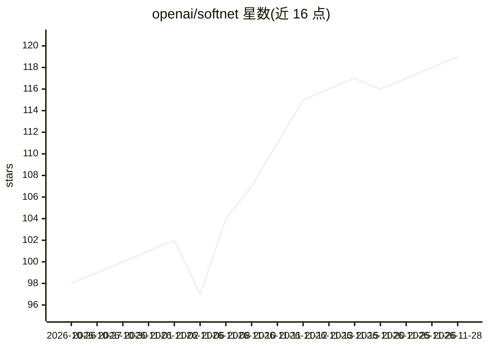

# openai/softnet

⭐ 119 · Rust · NOASSERTION · 推送 2026-11-22 · [GitHub](https://github.com/openai/softnet) · 组织维护

**为 Tart 虚拟机提供网络隔离与 DHCP 短缺缓解**

面向 macOS 虚拟机管理工具 Tart 的用户态网络组件：以用户态包过滤器限制 VM 流量（限定自身 MAC/IP、全局可路由 IPv4 等），防御 ARP 欺骗等安全问题；自带 DHCP 服务器将租约从 86400 秒降至 600 秒，缓解大量临时 VM 场景下的 DHCP 地址耗尽。一个进程最多承载 5 个 VM 共享 /29 子网，支持 JSON-RPC 2.0 控制通道动态更新 allow/block 策略与逐 VM WireGuard 路由。要求 macOS 26 及以上，二进制需 SUID 或免密 sudo。

## 筛选速览

| 维度 | 判定 | 备注 |
|---|---|---|
| AI 角色 | `ai-enhanced` | 去掉 AI 部分产品仍成立 |
| 许可风险 | `none` | NOASSERTION |
| 部署形态 | `None` |  |
| 模型依赖 | — | README 未给出锁定关系 |
| 硬件要求 | — | 无带数字的原话,不猜 |
| 安装摩擦 | `low` | 无编译、无系统依赖或容器化 |
| 成熟度 | — | 结构信号不足 |

## 能力要点

- 用户态包过滤器限制 VM 流量并防御 ARP 欺骗
- 自带 DHCP 服务器，租约降至 600 秒缓解地址耗尽
- JSON-RPC 2.0 控制通道支持不重启 VM 动态更新策略
- 逐 VM WireGuard 隧道路由

## 适用场景

- CI 服务批量创建临时 VM 时避免 DHCP 地址耗尽
- 限制 VM 出站流量为默认拒绝并按前缀放行
- 将 VM 流量经 WireGuard 隧道转发到指定网段

## 场景标签

 · 领域:虚拟化/网络基础设施

## 证据(README 行号)

> L3: Softnet is a software networking for Tart which provides better network isolation and alleviates DHCP shortage on pr
> L5: It is essentially a userspace packet filter which restricts the VM networking and prevents a class of security issue

## 星数曲线

2026-10-26 98 → 2026-11-28 119（+21）

---
*卡片 v1 · prompt 1.4 · 生成 2026-11-28 · 置信度 mid · 依据 README sha `0efeae0de1f0` · [字段定义](../../DATASET.md)*
