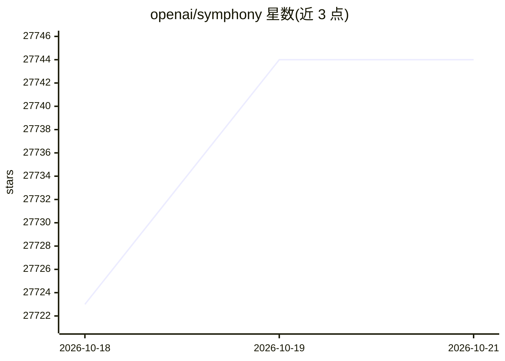

# openai/symphony

⭐ 27,744 · Elixir · Apache-2.0 · 推送 2026-09-15 · [GitHub](https://github.com/openai/symphony) · [官网](https://openai.com/index/open-source-codex-orchestration-symphony/) · 组织维护

**给工程团队的自主编码任务编排器：监控任务板并派发 agent 执行**

Symphony 将项目工作转化为隔离的、自主的实现运行（implementation runs），团队通过管理任务而非逐个监督编码 agent。机制上：监控 Linear 任务板，为任务生成 agent，agent 完成任务后提供工作量证明（CI 状态、PR 审查反馈、复杂度分析、演示视频），被接受后安全合入 PR。适合已采用 harness engineering 的代码库。README 标注为工程预览版，建议在可信环境中测试。提供两种获取方式：按 SPEC.md 自行实现，或使用 Elixir 参考实现。

## 筛选速览

| 维度 | 判定 | 备注 |
|---|---|---|
| AI 角色 | `ai-enhanced` | 去掉 AI 部分产品仍成立 |
| 许可风险 | `permissive` | Apache-2.0 |
| 部署形态 | `None` |  |
| 模型依赖 | — | README 未给出锁定关系 |
| 硬件要求 | — | 无带数字的原话,不猜 |
| 安装摩擦 | `low` | 无编译、无系统依赖或容器化 |
| 成熟度 | `idea` | |

## 动量与使用信号

- 维护:`active` — 距上次 push 32.4 天,年发版 4,9 位贡献者
- 涨星:近 1 天 **+17**(自 20261016 起算)

## 能力要点

- 监控 Linear 任务板并自动派发 agent 处理任务
- agent 提供工作量证明：CI 状态、PR 审查反馈、复杂度分析、视频
- 提供 SPEC.md 规范可自行实现，附 Elixir 参考实现
- 任务隔离运行，工程师以更高层级管理工作

## 适用场景

- 团队将任务板上的工作自动分派给编码 agent 执行
- 通过 CI 状态与 PR 反馈验收 agent 产出的代码
- 在已采用 harness engineering 的代码库中转向以工作为单元的管理方式

## 场景标签

`编码 Agent` · 领域:编码与开发

## 证据(README 行号)

> L3: Symphony turns project work into isolated, autonomous implementation runs, allowing teams to manage
> L8: _In this demo video, Symphony monitors a Linear board for work and spawns agents to handle the tasks. The agents com
> L11: > Symphony is a low-key engineering preview for testing in trusted environments.

## 星数曲线

2026-10-18 27,723 → 2026-10-21 27,744（+21）

---
*卡片 v1 · prompt 1.4 · 生成 2026-10-18 · 置信度 mid · 依据 README sha `9f3867375e05` · [字段定义](../../DATASET.md)*
