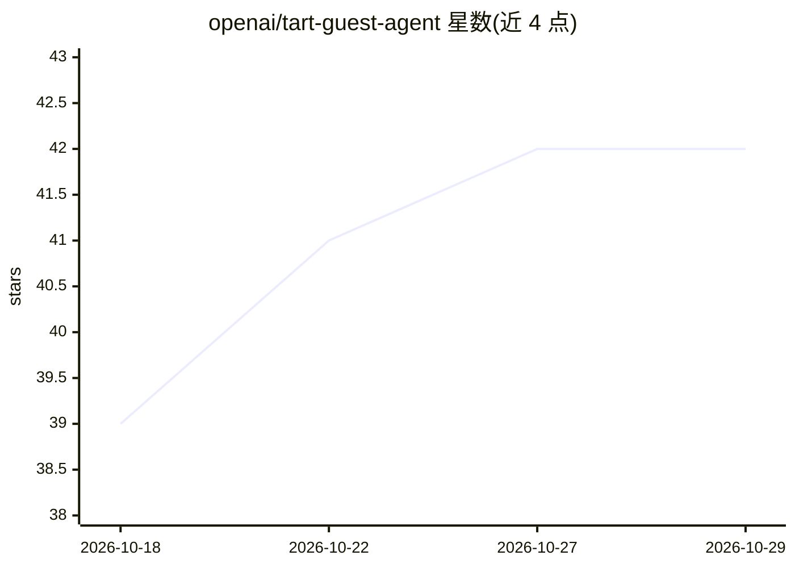

# openai/tart-guest-agent

⭐ 42 · Go · NOASSERTION · 推送 2026-10-14 · [GitHub](https://github.com/openai/tart-guest-agent) · 组织维护

**Tart 虚拟机内的客户机代理：主机与客户机通信及自动化功能**

运行在 macOS 虚拟机内部的后台轻量服务，为 Tart 虚拟化工具提供主机与客户机间的增强通信能力。已实现功能包括：自动磁盘扩容（需以 launchd 全局守护进程运行）、基于自研 SPICE vdagent 实现的剪贴板共享、tart exec 命令执行支持、无需依赖 DHCP/ARP 的 VM IP 解析。另提供 --exec-wrapper 机制，允许镜像管理员为所有 RPC 命令配置固定前缀且客户端无法禁用。面向使用 Tart 管理 macOS 虚拟机的开发与 CI 场景，以 launchd 配置（plist）方式部署。

## 筛选速览

| 维度 | 判定 | 备注 |
|---|---|---|
| AI 角色 | `ai-ecosystem` | LLM/agent 周边工具 |
| 许可风险 | `none` | NOASSERTION |
| 部署形态 | `None` |  |
| 模型依赖 | — | README 未给出锁定关系 |
| 硬件要求 | — | 无带数字的原话,不猜 |
| 安装摩擦 | `low` | 无编译、无系统依赖或容器化 |
| 成熟度 | — | 结构信号不足 |

## 能力要点

- 自动磁盘扩容（针对已移除恢复分区的 macOS VM）
- 基于自研 SPICE vdagent 的剪贴板共享
- tart exec 与 tart ip --resolver=agent 的 RPC 支持
- 可配置且客户端不可禁用的命令执行前缀（--exec-wrapper）

## 适用场景

- 在 Tart 管理的 macOS 虚拟机中启用剪贴板共享与自动扩容
- 通过 tart exec 在虚拟机内执行命令
- 为托管镜像统一注入所有执行命令的环境变量

## 场景标签

 · 领域:虚拟化/系统工具

## 证据(README 行号)

> L1: # Guest agent for Tart VMs
> L3: A guest agent for Tart VMS is a lightweight background service that runs inside the virtual machine and enables enha

## 星数曲线

2026-10-18 39 → 2026-10-29 42（+3）

---
*卡片 v1 · prompt 1.4 · 生成 2026-10-25 · 置信度 low · 依据 README sha `ada951da1c8b` · [字段定义](../../DATASET.md)*
