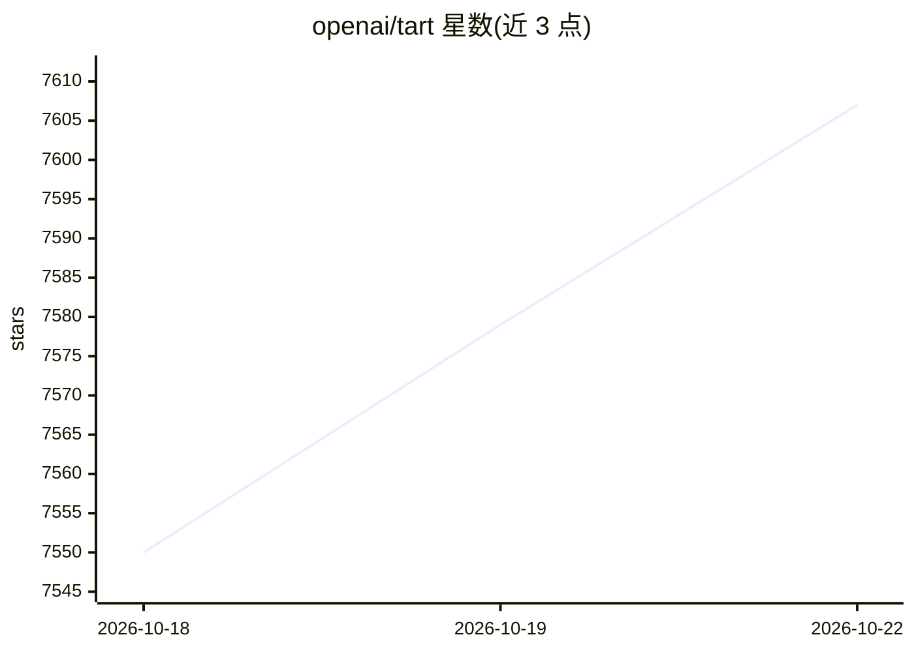

# openai/tart

⭐ 7,607 · Swift · NOASSERTION · 推送 2026-10-20 · [GitHub](https://github.com/openai/tart) · [官网](https://tart.run) · 组织维护

**Apple Silicon 上构建、运行和管理 macOS/Linux 虚拟机的工具集**

Tart 是面向 Apple Silicon 设备的虚拟化工具集，基于 Apple 自带的 Virtualization.Framework 构建、运行和管理 macOS 与 Linux 虚拟机，面向 CI 工程师与自动化场景。支持从任意 OCI 兼容容器仓库 Push/Pull 虚拟机镜像，可通过 Tart Packer Plugin 自动化创建 VM，并可集成到任意 CI 系统。通过 Homebrew 安装，要求 macOS 13.0（Ventura）及以上，示例会下载约 25 GB 镜像。README 中未涉及 AI 模型相关功能。

## 筛选速览

| 维度 | 判定 | 备注 |
|---|---|---|
| AI 角色 | `ai-ecosystem` | LLM/agent 周边工具 |
| 许可风险 | `none` | NOASSERTION |
| 部署形态 | `None` |  |
| 模型依赖 | — | README 未给出锁定关系 |
| 硬件要求 | — | 无带数字的原话,不猜 |
| 安装摩擦 | `low` | 无编译、无系统依赖或容器化 |
| 成熟度 | — | 结构信号不足 |

## 能力要点

- 使用 Apple Virtualization.Framework 运行 macOS/Linux VM
- 支持从 OCI 兼容容器仓库 Push/Pull 虚拟机
- Tart Packer Plugin 自动化 VM 创建
- 可集成任意 CI 系统

## 适用场景

- 在 Apple Silicon 设备上运行 macOS/Linux 虚拟机用于 CI
- 通过 OCI 注册表在团队间分发虚拟机镜像
- 用 Packer 插件自动化构建 VM 镜像

## 场景标签

 · 领域:虚拟化/CI 基础设施

## 证据(README 行号)

> L1: *Tart* is a virtualization toolset to build, run and manage macOS and Linux virtual machines (VMs) on Apple Silicon.
> L4: * Tart uses Apple's own `Virtualization.Framework` for near-native performance.

## 星数曲线

2026-10-18 7,550 → 2026-10-22 7,607（+57）

---
*卡片 v1 · prompt 1.4 · 生成 2026-10-20 · 置信度 low · 依据 README sha `71eea958e605` · [字段定义](../../DATASET.md)*
