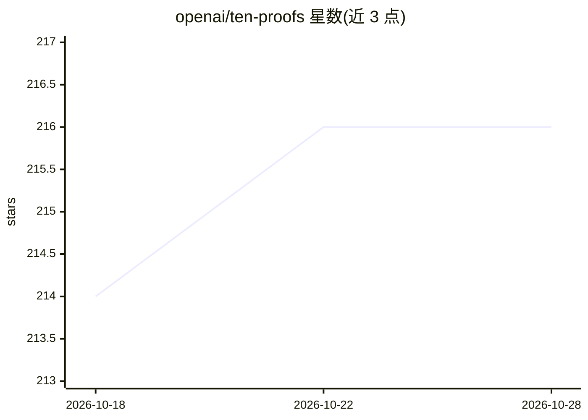

# openai/ten-proofs

⭐ 217 · Lean · Apache-2.0 · 推送 2026-08-05 · [GitHub](https://github.com/openai/ten-proofs) · 组织维护

**十项数学与理论计算机科学结果的 Lean 4 形式化证明仓库**

OpenAI 发布的论文《Ten advances in mathematics and theoretical computer science》配套证明仓库：以 Lean 4（32.0 版本、依赖 mathlib 与 Lake）对十项结果给出形式化证书，覆盖高维球堆积、二进制与球面码、非 sofic 群构造、Connes 刚性猜想反例、算术电路下界、量子并行重复、最近向量问题、Ehrhart 体积不等式、多色拉姆齐数与极图猜想反例。通过 lake 构建全部或单个模块，并附 Comparator 独立证明检查说明。面向数学与形式化验证研究者。

## 筛选速览

| 维度 | 判定 | 备注 |
|---|---|---|
| AI 角色 | `ai-knowledge` | 知识聚合/清单类 |
| 许可风险 | `permissive` | Apache-2.0 |
| 部署形态 | `None` |  |
| 模型依赖 | — | README 未给出锁定关系 |
| 硬件要求 | — | 无带数字的原话,不猜 |
| 安装摩擦 | `low` | 无编译、无系统依赖或容器化 |
| 成熟度 | — | 结构信号不足 |

## 能力要点

- 十项结果的 Lean 4 形式化证书，每项对应独立模块
- 依赖 Lean 4.32.0 与 mathlib，支持全部或按模块构建
- 提供 Comparator 独立证明检查的指引

## 适用场景

- 核验论文中十项定理的形式化证明
- 研究 Lean 4/mathlib 下前沿数学结果的形式化写法
- 作为 AI 生成证明的可检查证书来源

## 场景标签

 · 领域:数学/形式化验证

## 证据(README 行号)

> L3: This repository contains Lean 4 formalizations of the results presented in
> L4: Ten advances in mathematics and theoretical computer science by OpenAI.
> L46: The project uses Lean 4.32.0, mathlib, and Lake. With

## 星数曲线

2026-10-18 214 → 2026-10-28 216（+2）

---
*卡片 v1 · prompt 1.4 · 生成 2026-10-22 · 置信度 high · 依据 README sha `3582f5fb9df3` · [字段定义](../../DATASET.md)*
