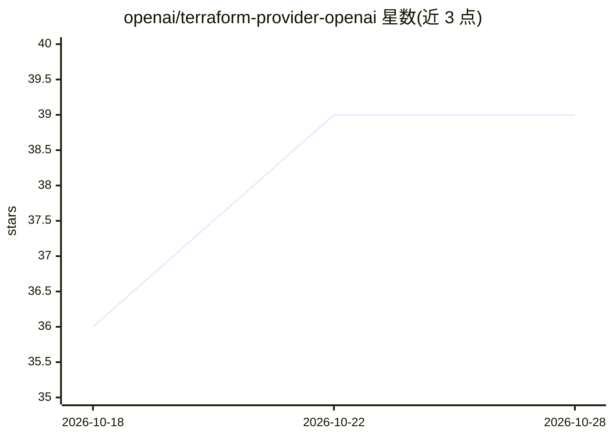

# openai/terraform-provider-openai

⭐ 39 · Go · Apache-2.0 · 推送 2026-10-28 · [GitHub](https://github.com/openai/terraform-provider-openai) · 组织维护

**官方 Terraform Provider，管理 OpenAI 组织与项目 webhook 资源**

OpenAI 官方维护的 Terraform Provider，通过 OpenAI Administration API 管理项目、用户、组、角色、服务账户、证书、速率限制与支出告警等组织级资源，并支持项目级 webhook 端点与事件类型发现（beta，schema 可能变化，不支持组织级 webhook 管理）。凭证按 API 受众路由：Admin API key 与项目 API key 不可互换，缺失时报告所需属性与环境变量。需 Terraform CLI 1.0+，通过设置环境变量配置凭证，另有私有 MCP 服务器的 Secure MCP 隧道指南与 Kubernetes 部署示例。

## 筛选速览

| 维度 | 判定 | 备注 |
|---|---|---|
| AI 角色 | `ai-ecosystem` | LLM/agent 周边工具 |
| 许可风险 | `permissive` | Apache-2.0 |
| 部署形态 | `None` |  |
| 模型依赖 | — | README 未给出锁定关系 |
| 硬件要求 | — | 无带数字的原话,不猜 |
| 安装摩擦 | `low` | 无编译、无系统依赖或容器化 |
| 成熟度 | `idea` | |

## 能力要点

- 管理 OpenAI Administration API 的组织资源（项目/用户/角色/速率限制/支出告警等）
- 项目级 webhook 端点与事件类型发现（beta）
- 凭证按 API 受众严格路由，Admin key 与项目 key 不可互换
- 提供私有 MCP 服务器的 Secure MCP 隧道指南与 Kubernetes 部署示例

## 适用场景

- 用基础设施即代码管理 OpenAI 组织的项目、用户与权限
- 以 Terraform 管理项目级 webhook 端点
- 在 CI/CD 流水线中通过环境变量注入凭证执行 terraform plan/apply

## 场景标签

 · 领域:云基础设施/DevOps

## 证据(README 行号)

> L1: # Terraform Provider for OpenAI
> L3: The OpenAI Terraform provider manages resources across two API audiences:

## 星数曲线

2026-10-18 36 → 2026-10-28 39（+3）

---
*卡片 v1 · prompt 1.4 · 生成 2026-10-25 · 置信度 high · 依据 README sha `087f7f472163` · [字段定义](../../DATASET.md)*
