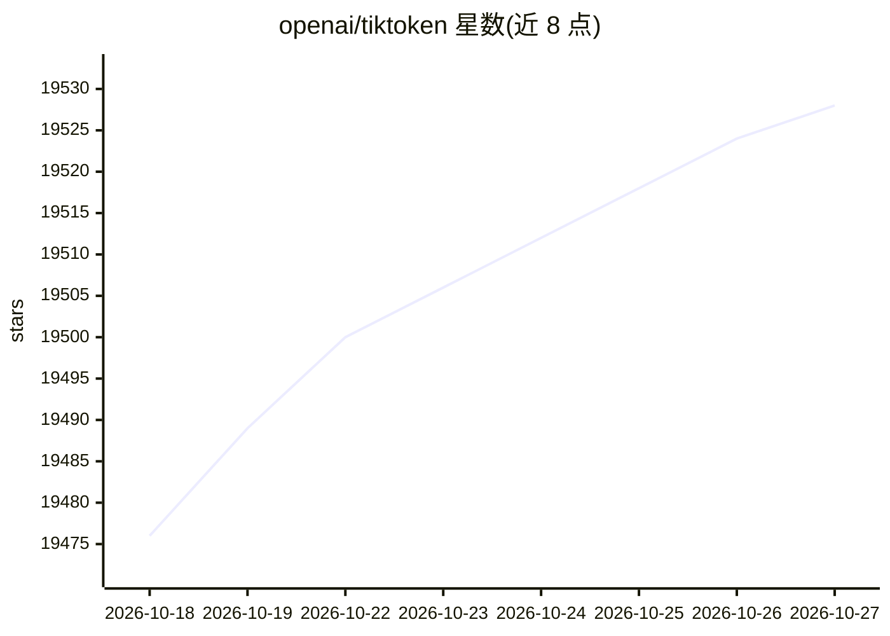

# openai/tiktoken

⭐ 19,528 · Python · MIT · 推送 2026-08-17 · [GitHub](https://github.com/openai/tiktoken) · 组织维护

**面向 OpenAI 模型的快速 BPE 分词器库**

tiktoken 是一个 BPE 分词 Python 库，提供编码/解码文本、按 OpenAI 模型名获取对应 tokeniser（如 gpt-4o）等 API，API 文档位于 tiktoken/core.py。文本可逆无损转换、支持任意文本、token 序列可压缩原文。附带 educational 子模块用于可视化 BPE 过程，并通过 tiktoken_ext 插件机制支持注册自定义 Encoding。从 PyPI 安装，示例代码在 OpenAI Cookbook。

## 筛选速览

| 维度 | 判定 | 备注 |
|---|---|---|
| AI 角色 | `ai-ecosystem` | LLM/agent 周边工具 |
| 许可风险 | `permissive` | MIT |
| 部署形态 | `library` | 以包/库形式分发 |
| 模型依赖 | — | README 未给出锁定关系 |
| 硬件要求 | — | 无带数字的原话,不猜 |
| 安装摩擦 | `low` | 无编译、无系统依赖或容器化 |
| 成熟度 | — | 结构信号不足 |

## 动量与使用信号

- 维护:`active` — 距上次 push 62.1 天,年发版 2,23 位贡献者
- 涨星:近 1 天 **+12**(自 20261016 起算)
- 安装:pypi 包 `tiktoken` 月下载 178,983,368
- 平台:— · 协议:OPENAI-API

## 能力要点

- 提供 encoding_for_model 按模型名获取对应分词器
- BPE 编码可逆无损、支持任意文本并压缩 token 序列
- educational 子模块可视化 BPE 训练过程
- tiktoken_ext 插件机制注册自定义编码

## 适用场景

- 计算文本在 OpenAI 模型下的 token 数
- 在 token 与原始文本之间互相转换
- 学习和可视化 BPE 分词原理
- 注册自定义编码以扩展分词支持

## 场景标签

 · 领域:LLM 基础设施/分词工具

## 证据(README 行号)

> L3: tiktoken is a fast BPE tokeniser for use with
> L12: enc = tiktoken.encoding_for_model("gpt-4o")
> L15: The open source version of `tiktoken` can be installed from PyPI:

## 星数曲线

2026-10-18 19,476 → 2026-10-27 19,528（+52）

---
*卡片 v1 · prompt 1.4 · 生成 2026-10-18 · 置信度 high · 依据 README sha `211949a9eaa0` · [字段定义](../../DATASET.md)*
