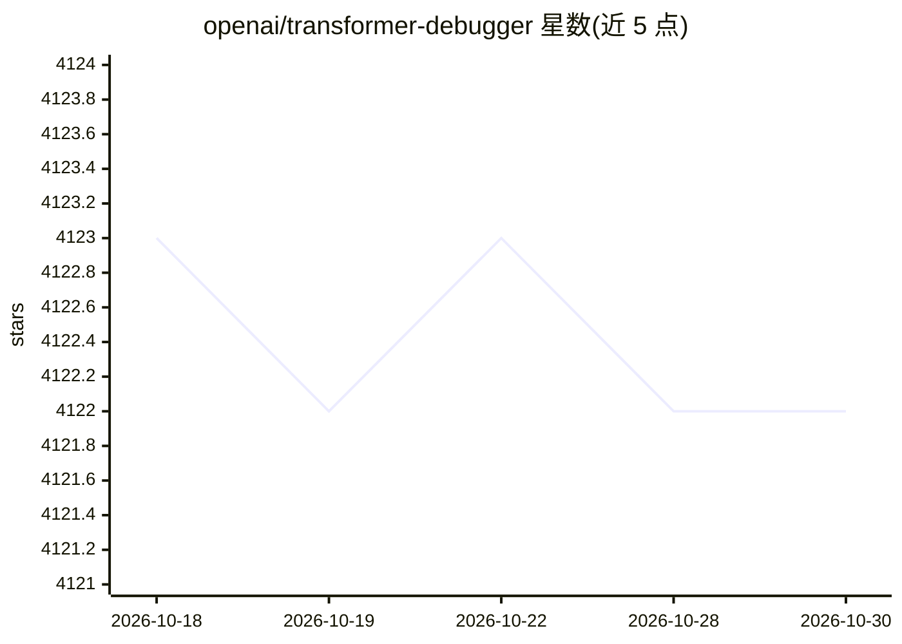

# openai/transformer-debugger

⭐ 4,122 · Python · MIT · 推送 2026-04-15 · [GitHub](https://github.com/openai/transformer-debugger) · 组织维护

**OpenAI 出品的小语言模型行为调查工具（可解释性）**

由 OpenAI Superalignment 团队开发的可解释性工具，结合自动化可解释性技术与稀疏自编码器，用于调查小语言模型的具体行为：定位促成某行为的组件（神经元、注意力头、自编码器 latent），展示自动生成的组件激活解释，并追踪组件间连接以发现回路；支持在正向传播中介入并观察影响。发布内容包括 React neuron viewer 前端、激活服务器后端、GPT-2 推理库及整理的激活数据集。安装需 Python/pip 与 node/npm，从源码克隆并运行前后端。

## 筛选速览

| 维度 | 判定 | 备注 |
|---|---|---|
| AI 角色 | `ai-ecosystem` | LLM/agent 周边工具 |
| 许可风险 | `permissive` | MIT |
| 部署形态 | `None` |  |
| 模型依赖 | — | README 未给出锁定关系 |
| 硬件要求 | — | 无带数字的原话,不猜 |
| 安装摩擦 | `low` | 无编译、无系统依赖或容器化 |
| 成熟度 | — | 结构信号不足 |

## 能力要点

- 定位促成特定行为的神经元/注意力头/自编码器 latent
- 在正向传播中介入并观察对行为的影响
- 自动生成组件激活解释并追踪组件连接（circuits）
- 发布含 neuron viewer 前端、激活服务器后端与 GPT-2 推理库

## 适用场景

- 调查模型为何在特定提示下输出某 token 而非另一个
- 研究注意力头/神经元的激活原因与组件间回路
- 在小语言模型上做可解释性探索，无需先写代码

## 场景标签

`科研工具` · 领域:学习与行业

## 证据(README 行号)

> L3: Transformer Debugger (TDB) is a tool developed by OpenAI's [Superalignment
> L6: automated interpretability

## 星数曲线

2026-10-18 4,123 → 2026-10-30 4,122（-1）

---
*卡片 v1 · prompt 1.4 · 生成 2026-10-20 · 置信度 high · 依据 README sha `c430e2a5e100` · [字段定义](../../DATASET.md)*
