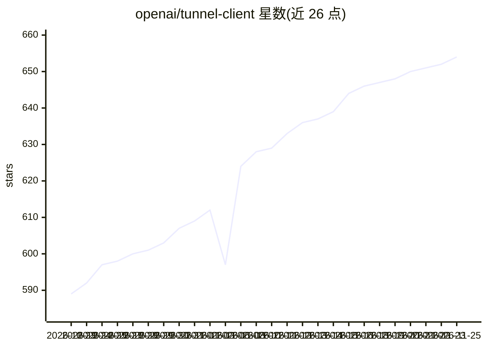

# openai/tunnel-client

⭐ 654 · Go · Apache-2.0 · 推送 2026-11-19 · [GitHub](https://github.com/openai/tunnel-client) · 组织维护

**客户自运行的隧道客户端，将私有 MCP 服务器安全接入 ChatGPT/Codex**

OpenAI 官方提供的 Go CLI 与 SDK，是 Secure MCP Tunnel 的客户侧组件：在私有或本地 MCP 服务器旁运行，通过 OpenAI 托管的 /v1/mcp/{tunnel_id} 端点，使 ChatGPT、Codex、Responses API 与 AgentKit 能访问该服务器，而无需暴露公网入站端点。提供 /healthz、/readyz、/metrics、/ui 运维端点、区域控制面选择、mTLS、请求 ID 转发、可选 W3C trace 转发、嵌入式演示 MCP stub，以及内存 transport 的 Go SDK 嵌入方式。macOS 经 Homebrew 安装并支持 brew services 开机自启。

## 筛选速览

| 维度 | 判定 | 备注 |
|---|---|---|
| AI 角色 | `ai-ecosystem` | LLM/agent 周边工具 |
| 许可风险 | `permissive` | Apache-2.0 |
| 部署形态 | `desktop` | 安装包/桌面程序 |
| 模型依赖 | — | README 未给出锁定关系 |
| 硬件要求 | — | 无带数字的原话,不猜 |
| 安装摩擦 | `low` | 无编译、无系统依赖或容器化 |
| 成熟度 | — | 结构信号不足 |

## 能力要点

- CLI 与 Go SDK 双形态，SDK 支持在 Go 进程内以内存 transport 嵌入 MCP 服务器
- 提供 /healthz、/readyz、/metrics、/ui 运维端点与 doctor/health 诊断命令
- 内嵌演示 MCP stub（server_info/echo/uppercase）可在无独立服务器时验证
- brew services 支持登录自启、配置文件托管与 shell 补全

## 适用场景

- 让 ChatGPT/Codex 访问笔记本、VM 或 Kubernetes 集群上的内部 MCP 服务器
- 安全部门不允许开放入站防火墙规则时的 MCP 接入方案
- 以 SDK 将 MCP 服务器与隧道客户端嵌入同一 Go 进程
- 将私有 MCP 服务器作为企业内受监管的守护进程运行

## 场景标签

 · 领域:AI 基础设施/MCP 连接

## 证据(README 行号)

> L3: `tunnel-client` is the customer-run agent behind Secure MCP Tunnel. It connects
> L5: the Responses API, and AgentKit through an OpenAI-hosted MCP tunnel endpoint,
> L8: This CLI and its Go SDK run beside your private MCP server.

## 星数曲线

2026-10-23 589 → 2026-11-25 654（+65）

---
*卡片 v1 · prompt 1.4 · 生成 2026-11-24 · 置信度 high · 依据 README sha `79979b31e122` · [字段定义](../../DATASET.md)*
