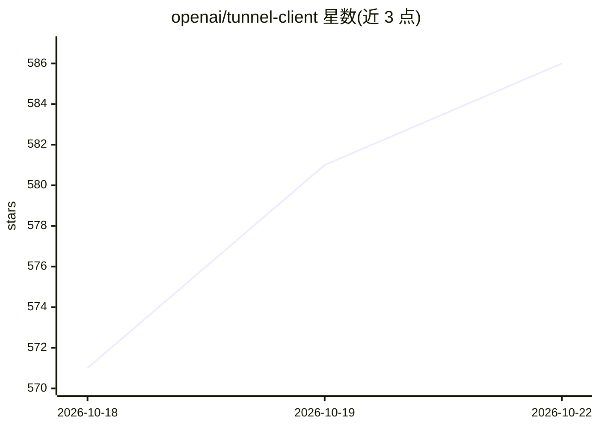

# openai/tunnel-client

⭐ 586 · Go · Apache-2.0 · 推送 2026-10-21 · [GitHub](https://github.com/openai/tunnel-client) · 组织维护

**OpenAI Secure MCP Tunnel 客户端：把本地/私有 MCP 服务接入 ChatGPT**

由 OpenAI 维护的命令行工具与 Go SDK，作为客户侧运行时，将部署在笔记本、VM、Kubernetes 或私有网络中的 MCP 服务器通过 OpenAI 托管的 /v1/mcp/{tunnel_id} 隧道端点连接到 ChatGPT、Codex、Responses API 与 AgentKit，使 MCP 服务器无需暴露公网即可被调用。提供 /healthz、/readyz、/metrics 与 /ui 运维端点，支持 Homebrew 安装、Docker/K8s/VM 部署文档及 Go SDK 进程内嵌入；需运行时 API key 与隧道 ID，stdio 模式下每个隧道 ID 仅支持一个活跃实例。

## 筛选速览

| 维度 | 判定 | 备注 |
|---|---|---|
| AI 角色 | `ai-ecosystem` | LLM/agent 周边工具 |
| 许可风险 | `permissive` | Apache-2.0 |
| 部署形态 | `desktop` | 安装包/桌面程序 |
| 模型依赖 | — | README 未给出锁定关系 |
| 硬件要求 | — | 无带数字的原话,不猜 |
| 安装摩擦 | `low` | 无编译、无系统依赖或容器化 |
| 成熟度 | — | 结构信号不足 |

## 能力要点

- 通过 OpenAI 托管隧道端点连接私有/本地 MCP 服务器，无需开放入站防火墙规则
- 同时提供 CLI 守护进程与可进程内嵌入的 Go SDK（配合 MCP SDK 内存传输）
- 内置 /healthz、/readyz、/metrics、/ui 运维端点与 embedded demo 工具
- 支持 W3C trace 上下文转发、请求 ID 转发与 OpenAPI 协议契约（docs/protocol.md、docs/openapi.json）

## 适用场景

- 把本机或内网的 MCP 服务器接入 ChatGPT / Codex 连接器
- 安全策略不允许开放入站端口时让 OpenAI 托管产品访问内部 MCP 工具
- 在 Go 进程内嵌入 MCP 服务器并通过隧道供远端调用

## 场景标签

 · 领域:LLM 基础设施/MCP 连接

## 证据(README 行号)

> L3: `tunnel-client` is the customer-run agent behind Secure MCP Tunnel. It connects
> L8: This CLI and its Go SDK run beside your private MCP server.
> L9: Applications call the OpenAI-hosted `/v1/mcp/{tunnel_id}` endpoint through their

## 星数曲线

2026-10-18 571 → 2026-10-22 586（+15）

---
*卡片 v1 · prompt 1.4 · 生成 2026-10-21 · 置信度 high · 依据 README sha `d04f223fd7da` · [字段定义](../../DATASET.md)*
