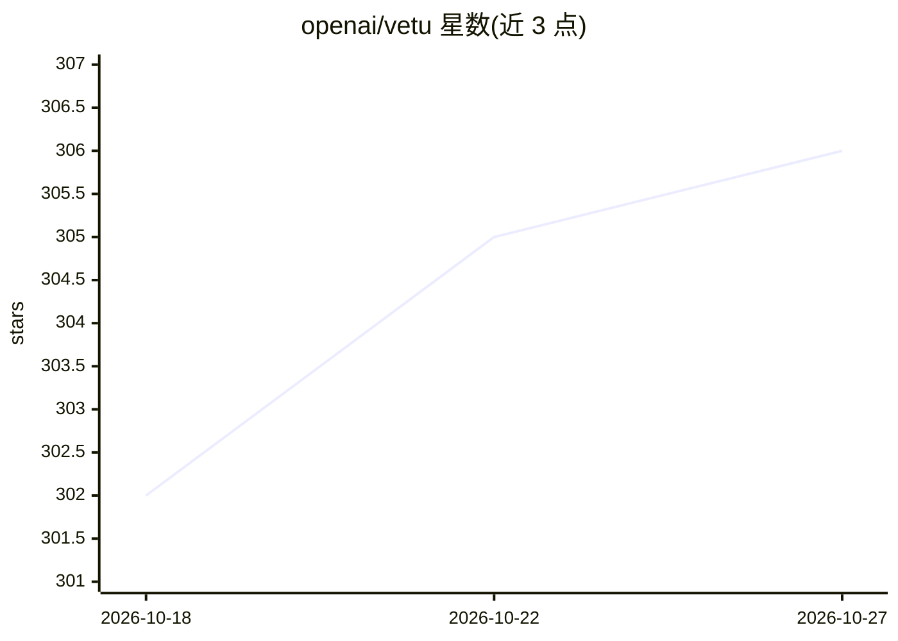

# openai/vetu

⭐ 306 · Go · NOASSERTION · 推送 2026-08-18 · [GitHub](https://github.com/openai/vetu) · 组织维护

**Linux 主机上易用的临时 Linux 虚拟机创建与运行工具**

基于 Cloud Hypervisor 的 Linux 虚拟化工具集，由 OpenAI 仓库发布，构建于 Tart 项目之上，将运行 VM 的流程抽象到接近容器的易用程度。支持将 VM 镜像推送/拉取到 OCI 兼容容器仓库、SSH 连接（默认 admin/admin，仅 localhost 可达）、Cirrus CLI 集成。网络提供 NAT（基于 gVisor TCP/IP 栈，免配置但速度受限）、Bridged 与 Host 三种模式。文件存储于 ~/.vetu/ 目录。本项目与 AI 无直接功能关联。

## 筛选速览

| 维度 | 判定 | 备注 |
|---|---|---|
| AI 角色 | `ai-enhanced` | 去掉 AI 部分产品仍成立 |
| 许可风险 | `none` | NOASSERTION |
| 部署形态 | `None` |  |
| 模型依赖 | — | README 未给出锁定关系 |
| 硬件要求 | — | 无带数字的原话,不猜 |
| 安装摩擦 | `low` | 无编译、无系统依赖或容器化 |
| 成熟度 | — | 结构信号不足 |

## 能力要点

- 基于 Cloud Hypervisor 运行 Linux 虚拟机
- VM 镜像可通过 OCI 兼容容器仓库推送/拉取
- NAT/Bridged/Host 三种网络模式
- 提供 Debian/RPM 包、预编译二进制与源码安装途径

## 适用场景

- 在 Linux 主机上快速创建并运行临时 Linux 虚拟机
- 像分发容器镜像一样在 OCI 仓库中分发 VM 镜像
- CI 环境中配合 Cirrus CLI 使用虚拟机

## 场景标签

 · 领域:虚拟化/开发工具

## 证据(README 行号)

> L3: _vetu_ is virtualization toolset to effortlessly run Cloud Hypervisor-backed virtual machines on Linux hosts.
> L7: Vetu builds on the success of Tart and abstracts all these peculiarities and makes the virtualization as easy as run

## 星数曲线

2026-10-18 302 → 2026-10-27 306（+4）

---
*卡片 v1 · prompt 1.4 · 生成 2026-10-21 · 置信度 mid · 依据 README sha `b3bf00e8864e` · [字段定义](../../DATASET.md)*
