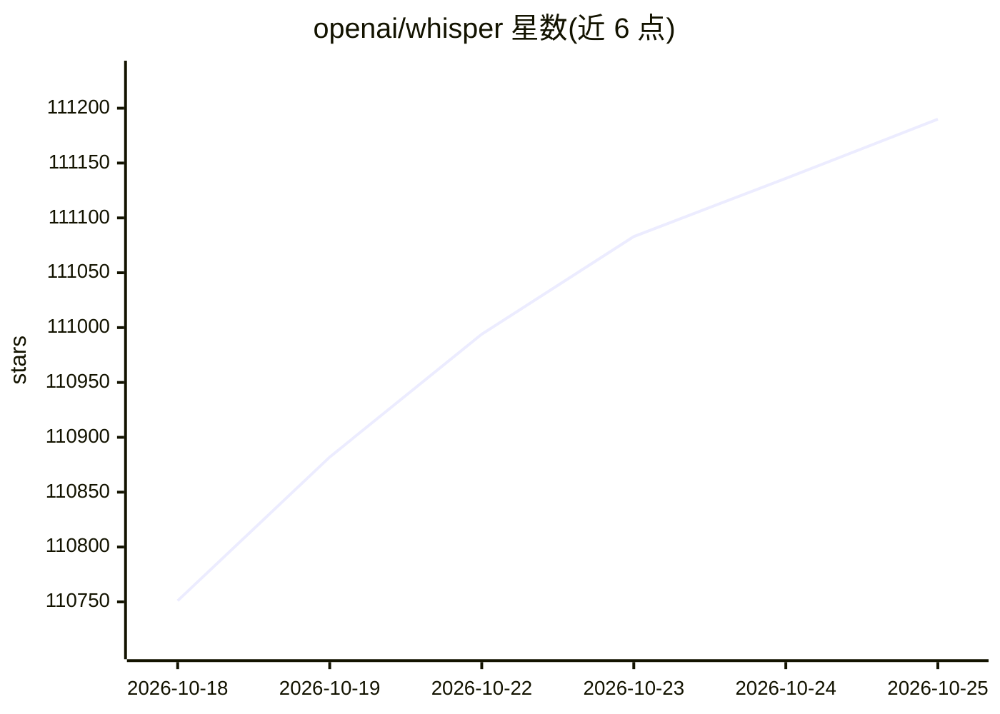

# openai/whisper

⭐ 111,190 · Python · MIT · 推送 2026-08-31 · [GitHub](https://github.com/openai/whisper) · 组织维护

**为开发者提供多语言语音识别与翻译的开源模型**

OpenAI 发布的通用语音识别模型，基于 Transformer 序列到序列架构，在大规模多语言音频数据上训练，可执行多语言语音识别、语音翻译、语言识别与语音活动检测，以单一模型替代传统多级语音处理流水线。提供 6 种模型规模（含 turbo 加速版），附带命令行工具与 Python API，依赖 ffmpeg 处理音频。代码与模型权重以 MIT 许可发布。

## 筛选速览

| 维度 | 判定 | 备注 |
|---|---|---|
| AI 角色 | `ai-native` | 本体是模型或模型工具 |
| 许可风险 | `permissive` | MIT |
| 部署形态 | `library` | 以包/库形式分发 |
| 模型依赖 | — | README 未给出锁定关系 |
| 硬件要求 | — | 无带数字的原话,不猜 |
| 安装摩擦 | `medium` | 含编译或系统依赖之一 |
| 成熟度 | — | 结构信号不足 |

## 动量与使用信号

- 维护:`active` — 距上次 push 47.6 天,年发版 0,84 位贡献者
- 涨星:近 1 天 **+100**(自 20261016 起算)
- 安装:pypi 包 `openai-whisper` 月下载 4,986,176
- 平台:WINDOWS / MACOS / LINUX · 协议:—

## 能力要点

- 单一模型支持多语言识别、语音翻译、语言识别与语音活动检测
- 提供 6 种模型规模（tiny 至 large，含 turbo），各档标注显存需求与相对速度
- 提供 CLI 与 Python 两种使用方式，代码与模型权重均以 MIT 许可发布

## 适用场景

- 将多语言音频文件转写为文本
- 把非英语语音翻译为英语
- 识别音频所属语言

## 场景标签

`语音识别` · 领域:感知与多模态

## 证据(README 行号)

> L8: Whisper is a general-purpose speech recognition model. It is trained on a large dataset of diverse audio and is also
> L14: A Transformer sequence-to-sequence model is trained on various speech processing tasks, including multilingual spee
> L127: Whisper's code and model weights are released under the MIT License. See LICENSE for further details.

## 星数曲线

2026-10-18 110,751 → 2026-10-25 111,190（+439）

---
*卡片 v1 · prompt 1.4 · 生成 2026-10-18 · 置信度 high · 依据 README sha `6ba1a9901bc5` · [字段定义](../../DATASET.md)*
