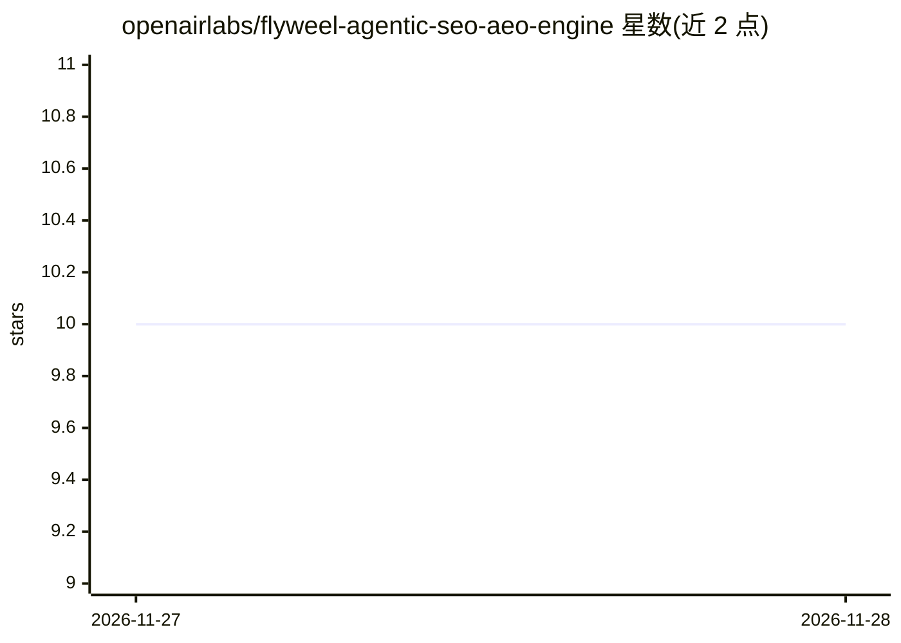

# openairlabs/flyweel-agentic-seo-aeo-engine

⭐ 10 · Python · MIT · 推送 2026-11-25 · [GitHub](https://github.com/openairlabs/flyweel-agentic-seo-aeo-engine) · [官网](https://github.com/openairlabs/fleo-by-flyweel) · 组织维护

**为营销者生成 SEO 优化博客文章的多模型 CLI 引擎**

开源 Python CLI 工具，通过多模型编排生成 SEO/AEO 优化的博客文章：并行做 SERP、Reddit、Quora 调研，生成约 1500-4500 字内容，输出带 frontmatter、JSON-LD 与 FAQ 的 Astro MDX 文件，支持 8 种内容风格与可选 GSC（Google Search Console）内耗检查。需自行配置 Perplexity/Groq/Google 等 API key 与品牌 JSON 配置。注意：该仓库已声明停止维护，由 Fleo（npx flyweel-fleo）接替，仅作历史参考保留。

## 筛选速览

| 维度 | 判定 | 备注 |
|---|---|---|
| AI 角色 | `ai-native` | 本体是模型或模型工具 |
| 许可风险 | `permissive` | MIT |
| 部署形态 | `library` | 以包/库形式分发 |
| 模型依赖 | — | README 未给出锁定关系 |
| 硬件要求 | — | 无带数字的原话,不猜 |
| 安装摩擦 | `low` | 无编译、无系统依赖或容器化 |
| 成熟度 | — | 结构信号不足 |

## 能力要点

- 多模型编排：调研、生成、润色各阶段使用不同模型
- 8 种内容风格（standard/guide/comparison/research 等）
- 输出生产可用的 Astro MDX，含 JSON-LD 与 schema frontmatter
- 可选 GSC 驱动的关键词内耗检查与刷新触发

## 适用场景

- 为品牌批量生成 SEO 优化的博客文章
- 生成带引用和 FAQ 的研究型长文
- 将 AI 内容生成以编程方式集成到应用中

## 场景标签

`AI 写作` · 领域:内容生成

## 证据(README 行号)

> L25: An open-source, lean AI content generator producing SEO-optimized blog posts via multi-model orchestration.
> L69: V2 is an automated content generation system that creates **high-quality, SEO-optimized blog posts** in **fast, mul

## 星数曲线

2026-11-27 10 → 2026-11-28 10（+0）

---
*卡片 v1 · prompt 1.4 · 生成 2026-11-27 · 置信度 mid · 依据 README sha `36770e52f721` · [字段定义](../../DATASET.md)*
