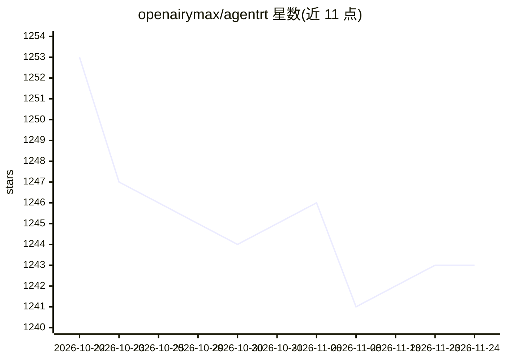

# openairymax/agentrt

⭐ 1,243 · C · NOASSERTION · 推送 2026-11-23 · [GitHub](https://github.com/openairymax/agentrt) · [官网](https://atomgit.com/openairymax) · 组织维护 · 中文 README

**AI Agent 运行时平台的自动化构建与发布工程目录**

该仓库是 AgentRT 项目的 `.github/` 自动化工程目录，承载跨平台构建测试、静态质量门禁、sanitizer 检测、契约生成校验、发布流水线与镜像同步。AgentRT 本体是一个 AI Agent 运行时平台，将多智能体认知循环、记忆演进、安全隔离与协议互操作收敛为统一运行时，以 git 子模块聚合 7 个叶子源码仓库，交付微内核原语、内存分层、网关服务与守护进程等 OS 级机制。面向使用者和参与开发者分别提供安装与贡献入口。

## 筛选速览

| 维度 | 判定 | 备注 |
|---|---|---|
| AI 角色 | `ai-ecosystem` | LLM/agent 周边工具 |
| 许可风险 | `none` | NOASSERTION |
| 部署形态 | `None` |  |
| 模型依赖 | — | README 未给出锁定关系 |
| 硬件要求 | — | 无带数字的原话,不猜 |
| 安装摩擦 | `low` | 无编译、无系统依赖或容器化 |
| 成熟度 | — | 结构信号不足 |

## 能力要点

- 提供 9 个平台的自包含安装包（Linux 5 架构、macOS 2、Windows 2）
- push/PR 触发三平台构建、静态质量门禁与 ASan/UBSan 检测
- 发布前在干净环境做离线安装与 daemon 启动核验，fail-closed
- 发布资产含 SHA256 校验、cosign 签名与清单，GitHub/Gitee/AtomGit 三端分发

## 适用场景

- 为 Agent 运行时平台获取多平台自包含安装包
- 按签名与清单校验发布资产完整性后离线安装
- 参与贡献时依赖流水线自动完成跨平台验证

## 场景标签

 · 领域:AI Agent 基础设施/工程化

## 证据(README 行号)

> L15: AgentRT（AirymaxAgentRT）是 AI Agent 运行时平台工程——定位类似于 Kubernetes
> L17: 与协议互操作收敛为一套统一运行时，定义 AI Agent 团队如何运行。

## 星数曲线

2026-10-22 1,253 → 2026-11-24 1,243（-10）

---
*卡片 v1 · prompt 1.4 · 生成 2026-11-23 · 置信度 high · 依据 README sha `061cdf0ccf12` · [字段定义](../../DATASET.md)*
