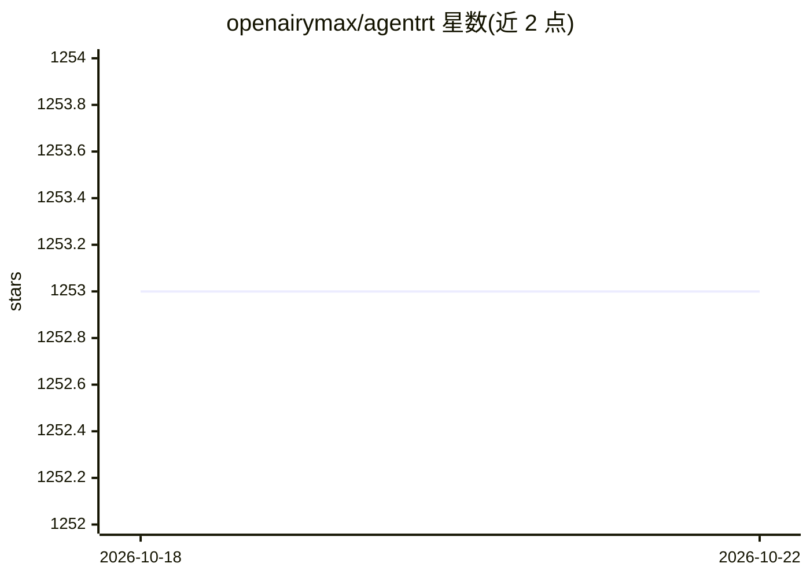

# openairymax/agentrt

⭐ 1,253 · C · NOASSERTION · 推送 2026-10-21 · [GitHub](https://github.com/openairymax/agentrt) · [官网](https://atomgit.com/openairymax) · 个人维护 · 中文 README

**AI Agent 多智能体运行时平台，含跨平台构建与发布自动化**

AgentRT 是 Airymax 维护的 AI Agent 运行时平台，以 git 子模块聚合 7 个叶子仓库（atoms/commons/cupolas/daemons/gateway/heapstore/protocols），交付微内核原语、认知循环、内存分层、安全隔离、IPC 协议、网关与守护进程等 OS 级机制。本 README 描述其 .github 自动化工程：三平台门禁测试、sanitizer、契约代码生成校验、覆盖 8 平台的 fail-closed 发布流水线（cosign/GPG 签名，AtomGit 为权威源，GitHub/Gitee 镜像），并提供自包含安装包与安装脚本，从源码构建需 cmake。

## 筛选速览

| 维度 | 判定 | 备注 |
|---|---|---|
| AI 角色 | `ai-ecosystem` | LLM/agent 周边工具 |
| 许可风险 | `none` | NOASSERTION |
| 部署形态 | `None` |  |
| 模型依赖 | — | README 未给出锁定关系 |
| 硬件要求 | — | 无带数字的原话,不猜 |
| 安装摩擦 | `low` | 无编译、无系统依赖或容器化 |
| 成熟度 | — | 结构信号不足 |

## 能力要点

- git 子模块聚合 7 个叶子仓库，交付记忆分层、安全隔离与 IPC 网关等运行时机制
- 每次提交跑 Linux/macOS/Windows 构建与 ASan/UBSan 检测
- Release 覆盖 8 个平台（Linux/macOS/Windows x86 与 arm），三段式签名发布
- 安装包自包含全部依赖，提供 install.sh / install.ps1 脚本

## 适用场景

- 在本地运行多智能体认知循环与分层记忆的 Agent 运行时
- 需要跨平台（含 arm）自包含部署与可验证签名的 Agent 基础设施
- 从 Release 页面离线安装并校验制品完整性

## 场景标签

 · 领域:AI Agent 基础设施/系统软件

## 证据(README 行号)

> L15: AgentRT（AirymaxAgentRT）是 AI Agent 运行时平台工程——定位类似于 Kubernetes
> L20: daemons / gateway / heapstore / protocols），对外交付微内核原语、认知循环、

## 星数曲线

2026-10-18 1,253 → 2026-10-22 1,253（+0）

---
*卡片 v1 · prompt 1.4 · 生成 2026-10-21 · 置信度 mid · 依据 README sha `3de23eeb3968` · [字段定义](../../DATASET.md)*
