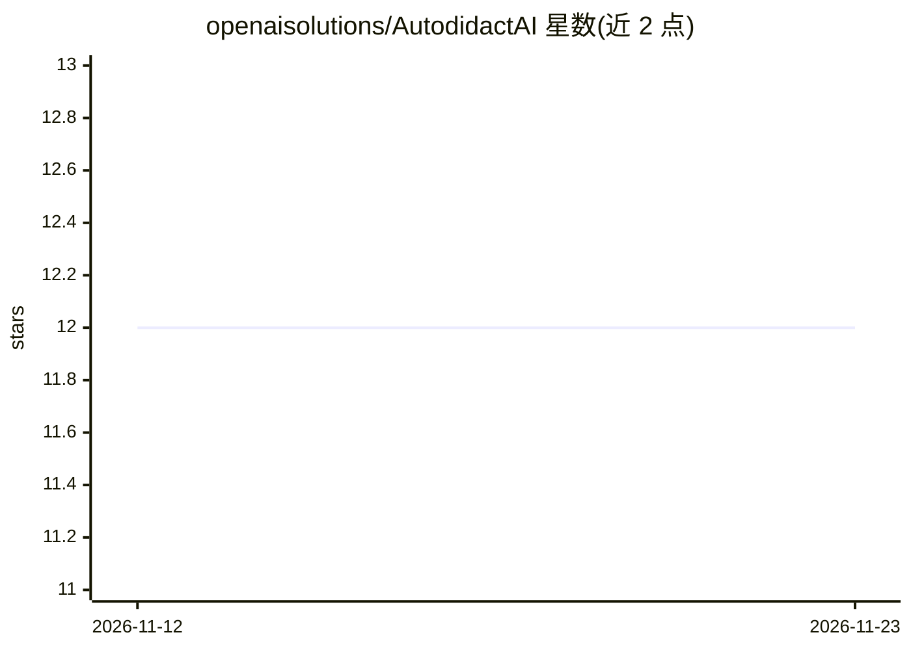

# openaisolutions/AutodidactAI

⭐ 12 · Python · MIT · 推送 2026-11-12 · [GitHub](https://github.com/openaisolutions/AutodidactAI) · [官网](https://www.openagilesolutions.com/blog) · 个人维护

**AI 驱动的自学学习平台概念设计（理论阶段）**

一个处于理论/蓝图阶段的自学型 AI 学习平台构想，愿景是用机器学习技术优化学习过程并提供个性化推荐，让用户自主学习感兴趣的领域，如语言学习与技能发展。README 明确当前无实际实现，项目已暂停活跃开发，主要讨论 AI 对齐问题的设计考量与安全责任原则。安装与使用仅指向外部文档，未提供具体命令。

## 筛选速览

| 维度 | 判定 | 备注 |
|---|---|---|
| AI 角色 | `ai-native` | 本体是模型或模型工具 |
| 许可风险 | `permissive` | MIT |
| 部署形态 | `None` |  |
| 模型依赖 | — | README 未给出锁定关系 |
| 硬件要求 | — | 无带数字的原话,不猜 |
| 安装摩擦 | `low` | 无编译、无系统依赖或容器化 |
| 成熟度 | `idea` | |

## 能力要点

- AI 驱动的个性化学习推荐（概念框架）
- 基于用户反馈的持续改进机制设计
- 以 AI 对齐与安全使用为首要设计考量

## 适用场景

- 了解一个自学型 AI 学习平台的概念设计
- 研究 AI 对齐在学习教育产品中的考量方式

## 场景标签

 · 领域:教育/自适应学习

## 证据(README 行号)

> L3: AutodidactAI is a proposed AI-driven platform that envisions facilitating coding, training, and working with AI. Alt
> L37: - AI-powered learning: AutodidactAI uses advanced machine learning techniques to optimize the learning process and 

## 星数曲线

2026-11-12 12 → 2026-11-23 12（+0）

---
*卡片 v1 · prompt 1.4 · 生成 2026-11-18 · 置信度 mid · 依据 README sha `cef46915fff6` · [字段定义](../../DATASET.md)*
