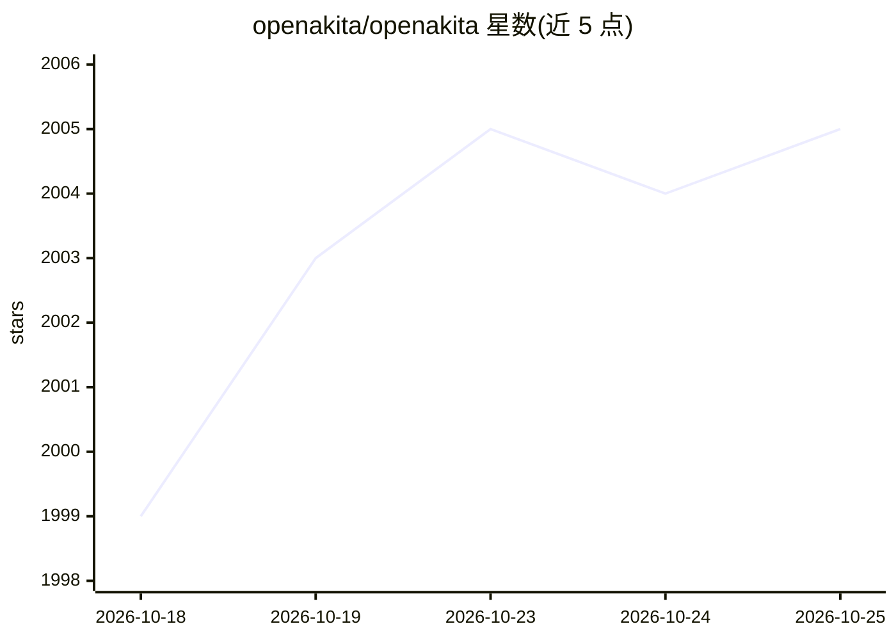

# openakita/openakita

⭐ 2,005 · Python · AGPL-3.0 · 推送 2026-09-24 · [GitHub](https://github.com/openakita/openakita) · [官网](http://openakita.ai) · 组织维护 · 中文 README

**开源多 Agent AI 助手：可组建自主运行的 AI 团队**

面向终端用户的开源 AI 助手框架：多个专职 Agent 并行协作，支持组织编排（CEO/CTO 等角色的 AI 公司）、ReAct 推理、计划模式、89+ 内置工具、6 层沙箱安全，可操作浏览器与桌面、管理文件、执行定时任务。接入 30+ LLM 提供商（含智能故障转移），通过扫码 30 秒绑定微信/飞书/企业微信/Telegram 等 6 个 IM 平台。提供 Tauri 桌面应用（GUI 配置、免命令行）、pip 安装与源码安装三种途径，另有 Web 与移动端访问。

## 筛选速览

| 维度 | 判定 | 备注 |
|---|---|---|
| AI 角色 | `ai-native` | 本体是模型或模型工具 |
| 许可风险 | `viral` | AGPL-3.0 |
| 部署形态 | `desktop` | 安装包/桌面程序 |
| 模型依赖 | locked-api |  |
| 硬件要求 | — | 无带数字的原话,不猜 |
| 安装摩擦 | `medium` | 含编译或系统依赖之一 |
| 成熟度 | — | 结构信号不足 |

## 能力要点

- 多 Agent 协作与组织编排（黑板共享、消息路由、死锁检测、自动扩缩容）
- 扫码绑定 6 个 IM 平台（微信/飞书/企业微信/Telegram/钉钉/QQ/OneBot）
- 8 类插件体系 + 89+ 内置工具 + MCP 客户端集成
- Tauri 2.x 桌面应用，全 GUI 配置，提供 Windows/macOS/Linux 安装包

## 适用场景

- 在微信/飞书/Telegram 里直接使用 AI 完成搜索、文件、定时任务
- 组建 CEO/CTO 等角色的 AI 公司并让其自主运行
- 用多个专职 Agent 并行完成研究、写作、编码等复合任务

## 场景标签

`多智能体` `AI 助手` `浏览器自动化` · 领域:Agent 开发

## 证据(README 行号)

> L35: OpenAkita is an open-source, all-in-one AI assistant — multiple AI Agents work together, build an **AI company** th
> L125: |🌐|**30+ LLM Providers**|Anthropic / OpenAI / DeepSeek / Qwen / Kimi / MiniMax / Gemini … smart failover|

## 星数曲线

2026-10-18 1,999 → 2026-10-25 2,005（+6）

---
*卡片 v1 · prompt 1.4 · 生成 2026-10-21 · 置信度 high · 依据 README sha `78452e0133b9` · [字段定义](../../DATASET.md)*
