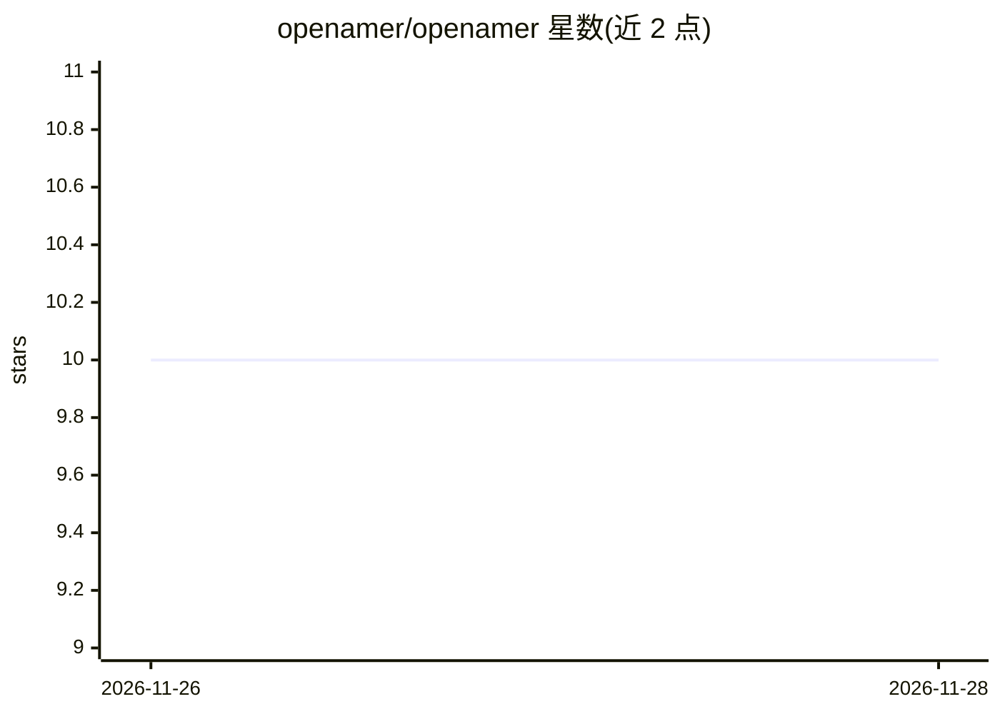

# openamer/openamer

⭐ 10 · Python · Apache-2.0 · 推送 2026-11-27 · [GitHub](https://github.com/openamer/openamer) · [官网](https://openamer.com/) · 组织维护

**自托管 AI agent：持久记忆、可扩展工具与后台桌面控制**

面向开发者的自托管 AI agent，可通过终端 CLI/TUI、桌面应用、Web 界面或消息网关运行；用户自行选择模型提供商（托管或兼容的本地推理），并配置工具后端。功能覆盖终端/文件/Python 执行、浏览器自动化（CDP）、后台 computer-use 录制与回放、持久记忆与技能、多 agent 委派协调、插件/MCP 扩展、智能家居集成及 A2A mesh 网络组件。部分运行时衍生自上游开源项目（见 NOTICE），许可证为 Apache-2.0；README 明确说明模型端点与相关凭据需自备。

## 筛选速览

| 维度 | 判定 | 备注 |
|---|---|---|
| AI 角色 | `ai-native` | 本体是模型或模型工具 |
| 许可风险 | `permissive` | Apache-2.0 |
| 部署形态 | `None` |  |
| 模型依赖 | — | README 未给出锁定关系 |
| 硬件要求 | — | 无带数字的原话,不猜 |
| 安装摩擦 | `low` | 无编译、无系统依赖或容器化 |
| 成熟度 | — | 结构信号不足 |

## 能力要点

- CLI/桌面/Web/消息网关四种运行界面，本地 profile 保存会话与知识
- 后台 computer-use 支持录制与回放（openamer computer-use record/play）
- 持久记忆、捆绑技能与 Skills Hub，支持插件、MCP 与钩子扩展
- 多 agent 委派、crews/swarm/Kanban 协调与 A2A mesh 守护进程

## 适用场景

- 让 agent 在 Windows 桌面上执行自动化操作并录制回放任务
- 接入自有模型端点搭建带持久记忆的个人助手
- 通过插件/MCP 扩展工具并与多个 agent 实例协同工作

## 场景标签

`多智能体` `浏览器自动化` `GUI 自动化` `AI 助手` · 领域:Agent 开发

## 证据(README 行号)

> L5: **A self-hosted AI agent with persistent memory, extensible tools, and background desktop control.**
> L7: OpenAmer runs through a terminal, a desktop app, a web interface, or a messaging
> L51: A model endpoint is required. You can use a supported hosted provider or a

## 星数曲线

2026-11-26 10 → 2026-11-28 10（+0）

---
*卡片 v1 · prompt 1.4 · 生成 2026-11-26 · 置信度 high · 依据 README sha `acc3933c1bbb` · [字段定义](../../DATASET.md)*
