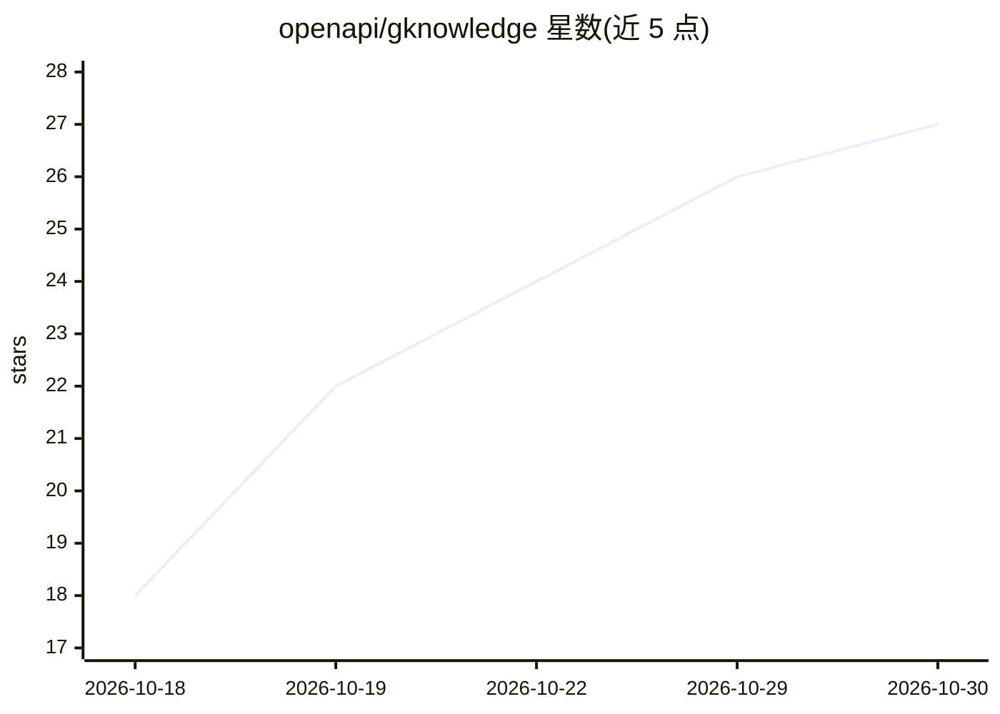

# openapi/gknowledge

⭐ 27 · Python · MIT · 推送 2026-10-27 · [GitHub](https://github.com/openapi/gknowledge) · [官网](https://openapi.github.io/gknowledge) · 组织维护 · 中文 README

**GNOME 原生桌面应用：把文档变成 LLM 持续维护的链接知识库**

基于 GTK 4/Libadwaita 的原生 GNOME 知识管理应用，实现 Karpathy 的 LLM Wiki 模式：导入文档后由引擎执行两步抽取（先分析后建页，记录来源），生成带 wikilinks 与 YAML frontmatter 的 Markdown 知识库，兼容 Obsidian；查询时以词汇检索加图扩展给出带引用的回答。默认内置离线启发式引擎，无需 API key；可接入 ChatGPT 账号、Ollama、LM Studio、vLLM 或任意 OpenAI 兼容端点。附带 MCP 服务器供 Claude Code、Codex、Cursor 读写同一知识库，并设有人工审核队列。提供 .deb、APT 仓库与 Flatpak 安装。

## 筛选速览

| 维度 | 判定 | 备注 |
|---|---|---|
| AI 角色 | `ai-native` | 本体是模型或模型工具 |
| 许可风险 | `permissive` | MIT |
| 部署形态 | `desktop` | 安装包/桌面程序 |
| 模型依赖 | local-ok | 支持本地模型 |
| 硬件要求 | — | 无带数字的原话,不猜 |
| 安装摩擦 | `medium` | 含编译或系统依赖之一 |
| 成熟度 | — | 结构信号不足 |

## 能力要点

- 两步抽取建页并记录来源（provenance），回答带引用
- 默认离线启发式引擎，无需账号或 API key
- 知识库为纯 Markdown 加可读 SQLite 索引，兼容 Obsidian
- 内置 MCP 服务器（gknowledge-mcp），供 Claude Code/Codex/Cursor 调用

## 适用场景

- 把研究论文等资料沉淀为持续更新、可追溯来源的知识库
- 在 Linux 桌面上离线对个人文档做带引用的问答
- 让编码 agent 通过 MCP 读写同一知识库

## 场景标签

`知识库管理` `文档问答` · 领域:知识与检索

## 证据(README 行号)

> L6:  Drop in your documents. Get a linked wiki that an LLM keeps up to date.
> L93: In April 2026 Andrej Karpathy described the LLM Wiki pattern: instead of re-reading raw documents on every question
> L106: - **Works with no model at all.** An offline engine ingests and answers; a model makes it better.

## 星数曲线

2026-10-18 18 → 2026-10-30 27（+9）

---
*卡片 v1 · prompt 1.4 · 生成 2026-10-27 · 置信度 high · 依据 README sha `9a9e44d0274a` · [字段定义](../../DATASET.md)*
