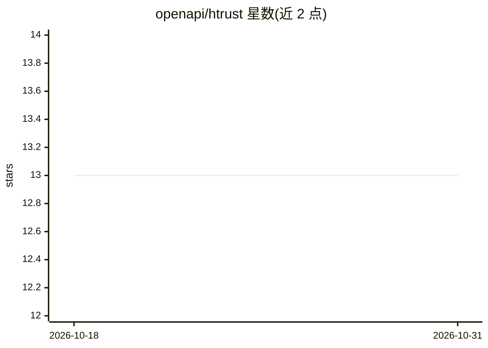

# openapi/htrust

⭐ 13 · Shell · MIT · 推送 2026-06-17 · [GitHub](https://github.com/openapi/htrust) · [官网](https://console.openapi.com) · 组织维护

**Rust 编写的信任核验 CLI：校验手机号/邮箱/IP/URL 等真实信息**

面向 Linux 系统管理员、shell 脚本与 agentic 工具的命令行程序：一条命令核验一种声明类型（mobile/email/ip/url），输出短状态与有语义的退出码（0 可信/1 不可信或错误/2 缺 token）。所有输入先经过本地静态校验（E.164、RFC 邮箱结构、IP/URL 格式），通过后才调用 trust.openapi.com 的远程核验 API，需通过环境变量提供 OPENAPI_TOKEN。从源码用 cargo/make 构建安装，暂无二进制发布物。当前版本仅封装该 API 的 6 个端点子集，iban/vat 等端点未接入。

## 筛选速览

| 维度 | 判定 | 备注 |
|---|---|---|
| AI 角色 | `ai-enhanced` | 去掉 AI 部分产品仍成立 |
| 许可风险 | `permissive` | MIT |
| 部署形态 | `None` |  |
| 模型依赖 | — | README 未给出锁定关系 |
| 硬件要求 | — | 无带数字的原话,不猜 |
| 安装摩擦 | `medium` | 含编译或系统依赖之一 |
| 成熟度 | `idea` | |

## 能力要点

- 每类声明一命令一位置参数，stdout 短状态 + 有语义退出码（0/1/2）
- 先本地静态校验再调远程 API，格式错误不消耗配额也不外泄值
- 支持 --sandbox、--detail、--json/--full 与端点映射（start/advanced）
- 提供 cargo 单元测试、Bash smoke 测试与负例断言测试套件

## 适用场景

- shell 脚本中根据退出码分支处理邮箱/手机号可信度
- agent 在执行动作前先核验 URL/IP/联系方式等真实信息
- 用沙箱环境与 --json 集成核验结果到自动化流程

## 场景标签

 · 领域:开发者工具/信任核验

## 证据(README 行号)

> L5: `htrust` is a Rust CLI for Linux sysadmins, shell scripts, and agentic tooling that need to check whether real-world

## 星数曲线

2026-10-18 13 → 2026-10-31 13（+0）

---
*卡片 v1 · prompt 1.4 · 生成 2026-10-31 · 置信度 mid · 依据 README sha `bb9afcb5732a` · [字段定义](../../DATASET.md)*
