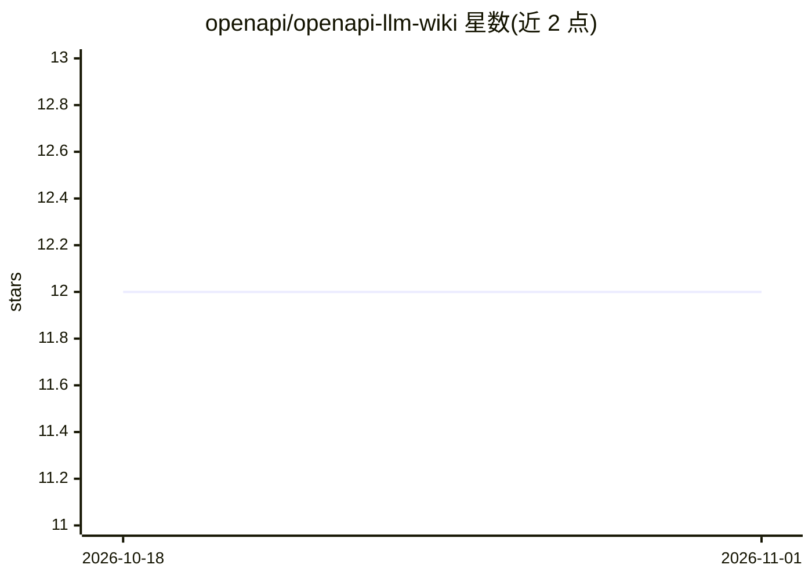

# openapi/openapi-llm-wiki

⭐ 12 · Python · MIT · 推送 2026-10-26 · [GitHub](https://github.com/openapi/openapi-llm-wiki) · [官网](https://console.openapi.com) · 组织维护

**面向 LLM/Agent 的 Openapi API 市场结构化知识库**

Openapi 团队维护的 LLM 优化知识库：以 Markdown 与原始 OpenAPI 3 规范组织公司简介、平台架构、API 目录、服务端点与 FAQ，供 AI agent 加载作为接地（grounding）上下文。提供五种消费方式：粘贴到对话、接入向量库/文件检索、通过 MCP 资源或 GitMCP 远程 MCP server 暴露、llms.txt/llms-full.txt 索引、人工浏览。CI 每周一从规范源头刷新并重新生成摘要，过时即失败。知识范围限定于 Openapi 平台，MIT 许可。

## 筛选速览

| 维度 | 判定 | 备注 |
|---|---|---|
| AI 角色 | `ai-knowledge` | 知识聚合/清单类 |
| 许可风险 | `permissive` | MIT |
| 部署形态 | `None` |  |
| 模型依赖 | — | README 未给出锁定关系 |
| 硬件要求 | — | 无带数字的原话,不猜 |
| 安装摩擦 | `low` | 无编译、无系统依赖或容器化 |
| 成熟度 | — | 结构信号不足 |

## 能力要点

- knowledge/ 目录按服务组织端点表与原始 OAS JSON 规范
- llms.txt / llms-full.txt 单文件打包全库，可直接粘贴或抓取
- 经 GitMCP 暴露为远程 MCP server，支持 MCP 客户端检索
- CI 每周自动刷新 OpenAPI 规范并重新生成 llms.txt

## 适用场景

- 让 AI agent 准确回答 Openapi API 市场的认证、端点、计费问题
- 为 agent 框架提供 Openapi 服务的检索式知识库
- 让 LLM 生成调用 Openapi API 的 curl 命令

## 场景标签

`知识库管理` `精选清单` · 领域:知识与检索

## 证据(README 行号)

> L17:  An LLM-optimized knowledge base to ground any AI agent on the Openapi® API marketplace
> L27: A structured, LLM-optimized knowledge base for the Openapi API marketplace.
> L28: Drop the contents of `knowledge/` into any LLM context to ground it with authoritative,

## 星数曲线

2026-10-18 12 → 2026-11-01 12（+0）

---
*卡片 v1 · prompt 1.4 · 生成 2026-11-01 · 置信度 high · 依据 README sha `cdb3fa00aa6f` · [字段定义](../../DATASET.md)*
