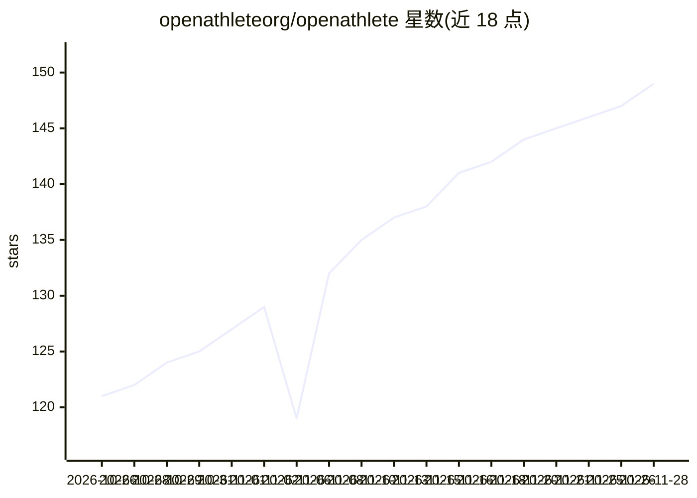

# openathleteorg/openathlete

⭐ 149 · TypeScript · AGPL-3.0 · 推送 2026-11-27 · [GitHub](https://github.com/openathleteorg/openathlete) · [官网](https://openathlete.org) · 个人维护

**面向跑者/骑手的开源可自托管耐力训练平台**

自托管耐力训练平台：提供训练日历、结构化 workout 同步到 Garmin/COROS/Suunto 手表、活动分析（爬坡检测、区间时间、CTL/ATL/TSB）与教练多学员面板。数据可随时导出，代码为 AGPL-3.0。AI 为可选功能：按句生成/编辑训练课、活动解读，采用 BYOK 模式接入多家模型服务商或本地模型，另提供 MCP server 供 Claude/ChatGPT/Cursor 读取训练数据。移动端有 App Store/Google Play 原生应用。

## 筛选速览

| 维度 | 判定 | 备注 |
|---|---|---|
| AI 角色 | `ai-enhanced` | 去掉 AI 部分产品仍成立 |
| 许可风险 | `viral` | AGPL-3.0 |
| 部署形态 | `library` | 以包/库形式分发 |
| 模型依赖 | locked-api |  |
| 硬件要求 | — | 无带数字的原话,不猜 |
| 安装摩擦 | `low` | 无编译、无系统依赖或容器化 |
| 成熟度 | — | 结构信号不足 |

## 能力要点

- 结构化 workout 同步至 Garmin、COROS、Suunto 手表
- AI 功能 BYOK：OpenAI/Anthropic/Google/Mistral 等多服务商或本地模型，按功能选模型
- MCP server 支持 Claude、ChatGPT、Cursor 读取训练并直接排课
- Docker 一键自托管脚本，支持域名 HTTPS 自动证书

## 适用场景

- 跑者/铁三选手规划赛季并同步训练课到手表
- 教练在一个面板管理多名学员并实时沟通
- 从 Garmin/Strava 等导入活动做负荷与恢复分析
- 注重隐私的用户自托管并保留全部训练数据

## 场景标签

`数据分析` · 领域:效率与自动化

## 证据(README 行号)

> L58: **AI, on your terms.** Generate or edit a session from a sentence, get a short read of each activity and three ques
> L66: |Open source, self-hostable|✅ AGPL-3.0|❌|❌|❌|
> L7:  The open-source training platform for runners, trail runners, triathletes, cyclists and their coaches.

## 星数曲线

2026-10-26 121 → 2026-11-28 149（+28）

---
*卡片 v1 · prompt 1.4 · 生成 2026-11-27 · 置信度 mid · 依据 README sha `9de7b25e3f71` · [字段定义](../../DATASET.md)*
