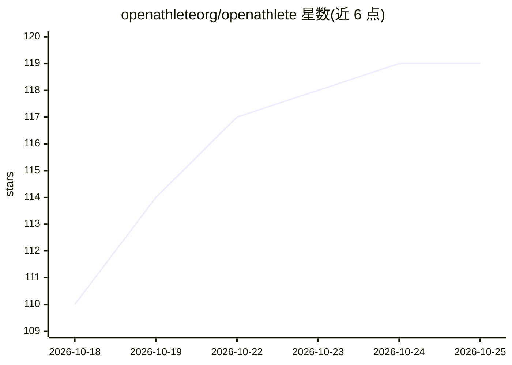

# openathleteorg/openathlete

⭐ 119 · TypeScript · AGPL-3.0 · 推送 2026-10-20 · [GitHub](https://github.com/openathleteorg/openathlete) · [官网](https://openathlete.org) · 个人维护

**可自托管的耐力训练平台：数据自主、开源替代 TrainingPeaks**

面向耐力运动（跑步/骑行等）的自托管训练追踪与训练负荷分析平台，AGPLv3 开源。提供训练/体能/疲劳/状态指标追踪、CTL/ATL/TSB 负荷计算（算法代码可审计）、Strava/Garmin/Polar/Suunto 设备同步、FIT/GPX 导入、可安装的 Web App 与 TestFlight iOS 应用，以及可配置 LLM 供应商的 AI 训练课生成辅助。技术栈 React/NestJS/PostgreSQL；支持 Docker Compose 脚本一键自托管与 EU/GDPR 定位。由 Grenoble 一位超级越野跑者维护。

## 筛选速览

| 维度 | 判定 | 备注 |
|---|---|---|
| AI 角色 | `ai-enhanced` | 去掉 AI 部分产品仍成立 |
| 许可风险 | `viral` | AGPL-3.0 |
| 部署形态 | `library` | 以包/库形式分发 |
| 模型依赖 | — | README 未给出锁定关系 |
| 硬件要求 | — | 无带数字的原话,不猜 |
| 安装摩擦 | `low` | 无编译、无系统依赖或容器化 |
| 成熟度 | — | 结构信号不足 |

## 能力要点

- CTL/ATL/TSB 训练负荷算法在代码中可审计可定制
- Strava/Garmin/Polar/Suunto 活动同步与 FIT/GPX 导入
- AI 课表生成与负荷监控辅助（可配置 LLM 供应商）
- Docker Compose 脚本一键自托管，EU 托管与 GDPR 定位

## 适用场景

- 我想要一个数据自持、可自托管的训练追踪平台
- 把 Garmin/Strava 等设备的训练数据集中管理并追踪体能指标
- 查看可审计的训练负荷算法而非黑箱计算

## 场景标签

 · 领域:运动健康/自托管应用

## 证据(README 行号)

> L47: - 🤖 **AI Assistance** — Modest helpers for session generation and load monitoring (not a replacement for a coach)
> L35: Endurance athletes feed years of intimate training data into proprietary U.S. platforms such as TrainingPeaks, Stra

## 星数曲线

2026-10-18 110 → 2026-10-25 119（+9）

---
*卡片 v1 · prompt 1.4 · 生成 2026-10-23 · 置信度 mid · 依据 README sha `70782880dd4a` · [字段定义](../../DATASET.md)*
