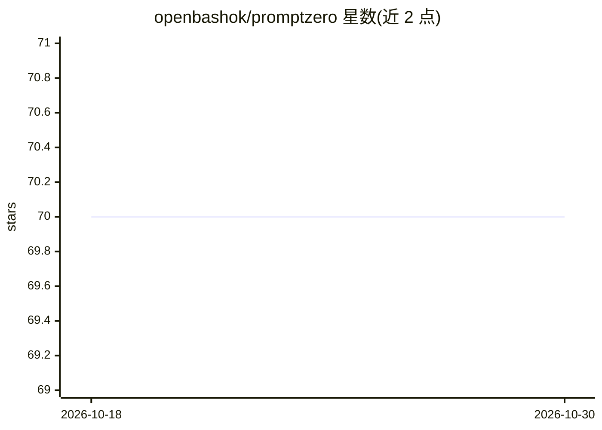

# openbashok/promptzero

⭐ 70 · Python · 推送 2026-05-18 · [GitHub](https://github.com/openbashok/promptzero) · [官网](https://openbash.com) · 组织维护

**给渗透测试者的 Claude API 本地脱敏代理，出站前替换敏感数据**

面向渗透测试人员的本地 FastAPI 代理，作为 api.anthropic.com 的替换端点运行：在提示词离开本机环境前，通过 Presidio+spaCy（英/西）NLP 层与正则层检测并替换 IP、主机名、凭据、人名、拉美多国身份证件等敏感数据为 IANA 保留段合成值，响应返回后再还原真实值；同一会话内映射保持一致。提供每请求彩色追踪行、/stats 与 /health 端点，并支持将上游流量经 Burp/mitmproxy 供自行核验。以 Docker 镜像或源码 setup.sh 安装运行。

## 筛选速览

| 维度 | 判定 | 备注 |
|---|---|---|
| AI 角色 | `ai-ecosystem` | LLM/agent 周边工具 |
| 许可风险 | `none` | — |
| 部署形态 | `self-host` | docker 或自建部署 |
| 模型依赖 | locked-api |  |
| 硬件要求 | — | 无带数字的原话,不猜 |
| 安装摩擦 | `low` | 无编译、无系统依赖或容器化 |
| 成熟度 | — | 结构信号不足 |

## 能力要点

- NLP（Presidio+spaCy en/es）+ 正则双层检测，覆盖 IP、凭据、拉美多国证件等类型
- 会话级双向映射表，同一真实值在会话内恒映射到同一合成值
- 合成值取自 IANA 保留文档段（RFC 5737/3849/2606）
- 上游流量可路由经 Burp/mitmproxy 逐字节核验，附每请求追踪行与 /stats 指标

## 适用场景

- 用 Claude 分析日志或写渗透测试报告时避免真实 IP、凭据、客户数据出站
- Claude Code CLI 经单一环境变量接入代理，实时查看每轮哪些敏感数据被脱敏
- 安全团队用 Burp 审计发往 API 的请求体以验证脱敏效果

## 场景标签

`网络安全` · 领域:学习与行业

## 证据(README 行号)

> L191: PromptZero is a **drop-in replacement** for `https://api.anthropic.com`.
> L110: ├── main.py          ← FastAPI proxy server (drop-in for api.anthropic.com)
> L111: ├── sanitizer.py     ← Detection engine: NLP (Presidio+spaCy) + Regex layers

## 星数曲线

2026-10-18 70 → 2026-10-30 70（+0）

---
*卡片 v1 · prompt 1.4 · 生成 2026-10-24 · 置信度 mid · 依据 README sha `867abf485198` · [字段定义](../../DATASET.md)*
