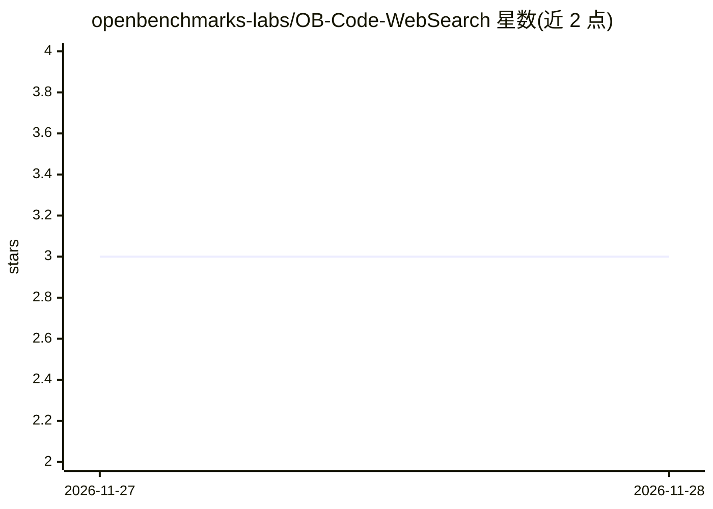

# openbenchmarks-labs/OB-Code-WebSearch

⭐ 3 · Python · MIT · 推送 2026-11-27 · [GitHub](https://github.com/openbenchmarks-labs/OB-Code-WebSearch) · [官网](https://openbenchmarks.com/web-search-for-coding-agents) · 组织维护

**面向开发者的网络搜索 API 独立基准评测与排行榜**

OpenBenchmarks Labs 维护的公开基准：给定针对企业产品 API（Workday、SAP、UKG、Veeva、Genesys、ServiceNow）的集成工单，让编码 agent 通过被测搜索 API 检索并产出最终 API 调用，由 judge 模块对照标准答案评分。固定模型、工单、搜索预算与运行窗口，仅更换搜索工具；Search only 与 Search & fetch 两块榜单分开排名，分数带 95% 置信区间。仓库含 30 道公开题目、13 个搜索工具配置与 harness/judge 代码，v2 私有集运行 8 个配置。

## 筛选速览

| 维度 | 判定 | 备注 |
|---|---|---|
| AI 角色 | `ai-knowledge` | 知识聚合/清单类 |
| 许可风险 | `permissive` | MIT |
| 部署形态 | `library` | 以包/库形式分发 |
| 模型依赖 | — | README 未给出锁定关系 |
| 硬件要求 | — | 无带数字的原话,不猜 |
| 安装摩擦 | `low` | 无编译、无系统依赖或容器化 |
| 成熟度 | — | 结构信号不足 |

## 能力要点

- 公开 30 道企业 API 集成工单题目，保留集防污染（sha256 标识）
- 固定协议：同一编码模型、轮次上限与搜索预算下对比搜索 API
- Search only 与 Search & fetch 两类榜单分开排名，分数带 95% 置信区间
- tools/ 提供 13 个搜索 API 的 YAML 配置，可提交 PR 接入新工具

## 适用场景

- 为编码 agent 选型网络搜索 API 时参考排行榜结果
- 复现离线验证流程或提交新搜索工具配置
- 查看各搜索 API 在企业 API 文档检索任务上的失败模式

## 场景标签

`模型评测` · 领域:评测与运维

## 证据(README 行号)

> L3: Open, independent benchmark of web search APIs for developers and coding agents: which search API helps a coding age
> L26: - **Public split:** 30 enterprise API tickets are committed in `data/questions.jsonl`. The Hugging Face dataset `op

## 星数曲线

2026-11-27 3 → 2026-11-28 3（+0）

---
*卡片 v1 · prompt 1.4 · 生成 2026-11-27 · 置信度 high · 依据 README sha `d97dd84591ee` · [字段定义](../../DATASET.md)*
