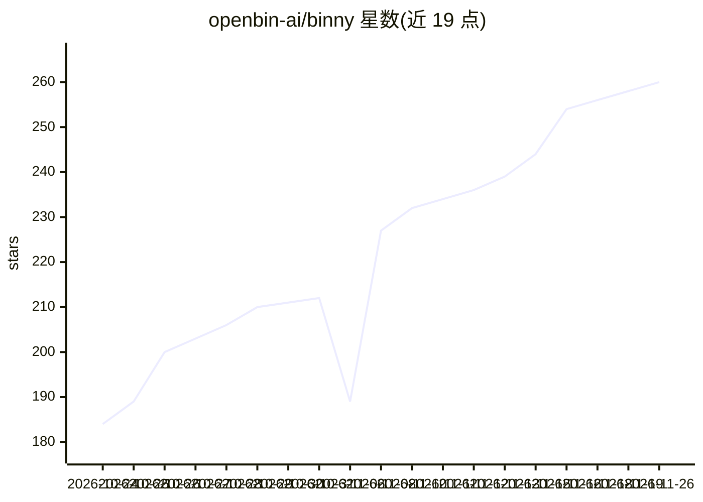

# openbin-ai/binny

⭐ 260 · Go · AGPL-3.0 · 推送 2026-11-23 · [GitHub](https://github.com/openbin-ai/binny) · [官网](https://openbin.ai/#binny) · 组织维护

**逆向工程开源 agent harness：接任意模型分析二进制并出报告**

BINNY 是面向逆向工程与恶意软件分析的 agent harness，本身不提供模型，而是组织工具（反编译函数、字符串、导入表、密封沙箱、本地 Ghidra/JADX）、分诊-调查-起草循环、预算与检查点、报告格式。用户插入自己的模型 key 或本地模型（Ollama/LM Studio/llama.cpp/vLLM），指向二进制或 APK，agent 通过可观测的工具调用逐函数调查，产出供人工审核的草稿报告。支持终端与浏览器图形界面及 Electron 独立桌面。需 Go 1.22+ 从源码构建；本地模型须支持工具调用且上下文窗口足够大。

## 筛选速览

| 维度 | 判定 | 备注 |
|---|---|---|
| AI 角色 | `ai-ecosystem` | LLM/agent 周边工具 |
| 许可风险 | `viral` | AGPL-3.0 |
| 部署形态 | `desktop` | 安装包/桌面程序 |
| 模型依赖 | local-ok | 支持本地模型 |
| 硬件要求 | — | 无带数字的原话,不猜 |
| 安装摩擦 | `low` | 无编译、无系统依赖或容器化 |
| 成熟度 | — | 结构信号不足 |

## 能力要点

- triaage→investigate→draft 循环，每步为可观测的工具调用
- 本地反编译：Ghidra 处理二进制、JADX 处理 APK，结果留在磁盘不上传
- 无网络、只读挂载、资源限制的 Docker 沙箱执行工具
- 自动保存与断点续跑；自主/监督/协作三种运行模式

## 适用场景

- 对可疑二进制或 APK 做恶意软件分诊与函数级调查
- 用本地模型在离线环境分析样本，数据不出本机
- 生成含 IOC、分类与覆盖度的分析报告草稿供审核
- 构建配置提取器、PoC 等防御性工件

## 场景标签

`网络安全` · 领域:学习与行业

## 证据(README 行号)

> L7: BINNY is the harness, not the model. It brings the tools (decompiled functions, strings, imports, data, a sealed san
> L66: Bring your own key. Anthropic, OpenAI, DeepSeek, Qwen, Kimi, Gemini (OpenAI-compatible) and Bedrock are preconfigur

## 星数曲线

2026-10-24 184 → 2026-11-26 260（+76）

---
*卡片 v1 · prompt 1.4 · 生成 2026-11-26 · 置信度 high · 依据 README sha `d9d7e236a299` · [字段定义](../../DATASET.md)*
