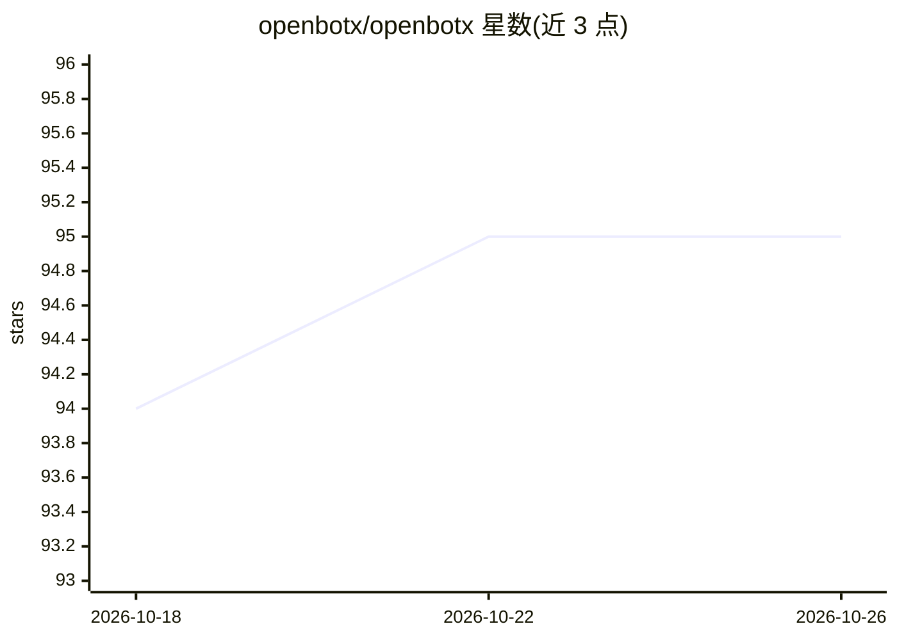

# openbotx/openbotx

⭐ 95 · Python · MIT · 推送 2026-03-03 · [GitHub](https://github.com/openbotx/openbotx) · [官网](https://openbotx.ai) · 个人维护

**浏览器内编排 AI agent 的开源平台，一条命令启动**

通过 Web 控制面板创建与管理多个 AI agent 的开源平台：支持为每个 agent 配置独立模型、工具与工作区，提供看板式实时任务板、Markdown 技能系统与社区技能市场、内置文件/Shell/浏览器自动化/调度器等工具，渠道覆盖 Web 与 Telegram。可用任意 LLM 提供商（Anthropic、OpenAI、Google、OpenRouter 或 OpenAI 兼容端点）。安全机制含沙箱工作区、Shell 安全防护与 JWT 认证。要求 Python 3.11+ 与 UV，一行命令启动，宣称无需编码。

## 筛选速览

| 维度 | 判定 | 备注 |
|---|---|---|
| AI 角色 | `ai-ecosystem` | LLM/agent 周边工具 |
| 许可风险 | `permissive` | MIT |
| 部署形态 | `library` | 以包/库形式分发 |
| 模型依赖 | — | README 未给出锁定关系 |
| 硬件要求 | — | 无带数字的原话,不猜 |
| 安装摩擦 | `low` | 无编译、无系统依赖或容器化 |
| 成熟度 | — | 结构信号不足 |

## 能力要点

- 多 agent 管理，各自独立模型、工具与工作区
- Markdown 技能系统与 Web 端社区技能市场
- 内置工具：文件操作、Shell、浏览器自动化、RSS、调度器等
- 支持 Anthropic/OpenAI/Google/OpenRouter 及 OpenAI 兼容端点，含沙箱与 JWT 认证

## 适用场景

- 在浏览器中创建和管理多个 AI agent 并分配任务
- 通过看板实时监控各 agent 的任务状态
- 用 Markdown 文件为 agent 扩展技能，无需编码

## 场景标签

`多智能体` `浏览器自动化` · 领域:Agent 开发

## 证据(README 行号)

> L13:  An open-source platform for orchestrating AI agents.
> L18: OpenBotX lets you create and manage AI agents from a web control panel. Chat, assign tasks, automate workflows, and

## 星数曲线

2026-10-18 94 → 2026-10-26 95（+1）

---
*卡片 v1 · prompt 1.4 · 生成 2026-10-23 · 置信度 high · 依据 README sha `080ec4ad0bf4` · [字段定义](../../DATASET.md)*
