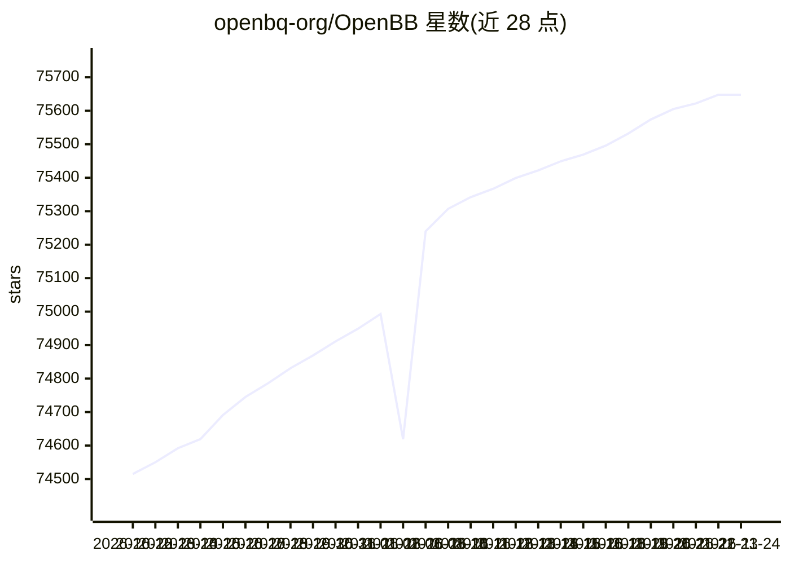

# openbq-org/OpenBB

⭐ 75,676 · Python · NOASSERTION · 推送 2026-11-18 · [GitHub](https://github.com/openbq-org/OpenBB) · [官网](https://openbb.co) · 组织维护

**为分析师、量化与 AI agent 整合多源金融数据的开放数据平台**

OpenBB 的开源数据集成工具集，将专有、许可与公开数据源接入下游应用。采用"一次接入、多处消费"架构：同一数据可经 Python 环境供量化使用、经 OpenBB Workspace 与 Excel 供分析师使用、经 MCP server 供 AI agent 使用、经 REST API 供其他应用使用。提供 pip 安装的 Python 包、CLI（openbb-cli），以及 openbb-api 命令启动 FastAPI/Uvicorn 本地服务（127.0.0.1:6900）供 Workspace 连接。需 Python 3.11–3.14 环境。

## 筛选速览

| 维度 | 判定 | 备注 |
|---|---|---|
| AI 角色 | `ai-enhanced` | 去掉 AI 部分产品仍成立 |
| 许可风险 | `none` | NOASSERTION |
| 部署形态 | `library` | 以包/库形式分发 |
| 模型依赖 | — | README 未给出锁定关系 |
| 硬件要求 | — | 无带数字的原话,不猜 |
| 安装摩擦 | `low` | 无编译、无系统依赖或容器化 |
| 成熟度 | — | 结构信号不足 |

## 动量与使用信号

- 维护:`active` — 距上次 push 1.6 天,年发版 11,259 位贡献者
- 涨星:近 1 天 **+55**(自 20261016 起算)
- 安装:pypi 包 `openbb` 月下载 60,485
- 平台:— · 协议:MCP

## 能力要点

- "connect once, consume everywhere"架构：Python/Excel/MCP server/REST API 多面暴露数据
- 提供 MCP server 供 AI agent 消费数据
- pip 安装的 Python 包与 CLI（openbb-cli）
- openbb-api 命令启动 FastAPI 本地服务

## 适用场景

- 为量化研究在 Python 中拉取股票价格历史数据
- 把自有数据源接入 OpenBB Workspace 供分析师可视化
- 通过 MCP server 让 AI agent 访问金融数据
- 以 REST API 向下游应用提供整合后的数据

## 场景标签

`金融量化` · 领域:学习与行业

## 证据(README 行号)

> L15: Open Data Platform by OpenBB (ODP) is the open-source toolset that helps data engineers integrate proprietary, lice
> L17: ODP operates as the "connect once, consume everywhere" infrastructure layer that consolidates and exposes data to m

## 星数曲线

2026-10-22 74,515 → 2026-11-24 75,648（+1,133）

---
*卡片 v1 · prompt 1.4 · 生成 2026-11-22 · 置信度 high · 依据 README sha `2c61321d4fd8` · [字段定义](../../DATASET.md)*
