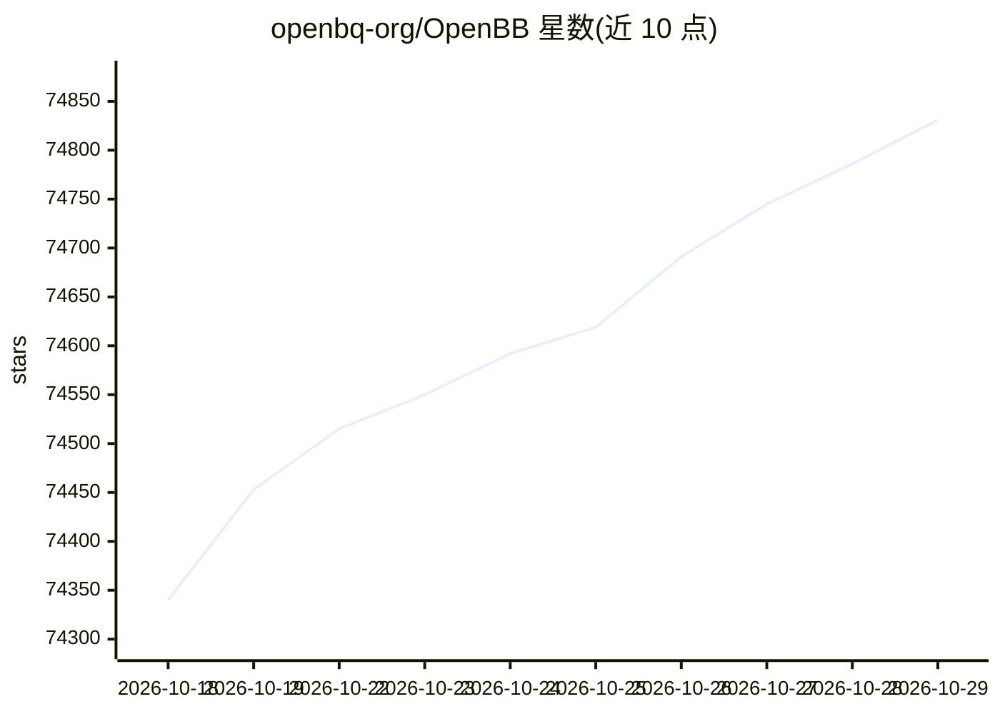

# openbq-org/OpenBB

⭐ 74,831 · Python · NOASSERTION · 推送 2026-10-24 · [GitHub](https://github.com/openbq-org/OpenBB) · [官网](https://openbb.co) · 组织维护

**为量化分析师与 AI agent 提供统一金融数据接入的开源平台**

OpenBB 的开放数据平台（ODP）是帮助数据工程师将专有、授权与公开数据源整合进下游应用的 Python 工具集，面向量化人员、分析师与 AI agent。核心机制为"一次连接、多处消费"：同一数据层同时暴露给 Python 环境、OpenBB Workspace/Excel、MCP 服务器与 REST API。安装通过 PyPI 的 pip 完成，`openbb-api` 命令可启动 FastAPI/Uvicorn 本地服务（127.0.0.1:6900）。数据准确性免责声明明确提示不保证准确。

## 筛选速览

| 维度 | 判定 | 备注 |
|---|---|---|
| AI 角色 | `ai-ecosystem` | LLM/agent 周边工具 |
| 许可风险 | `none` | NOASSERTION |
| 部署形态 | `library` | 以包/库形式分发 |
| 模型依赖 | — | README 未给出锁定关系 |
| 硬件要求 | — | 无带数字的原话,不猜 |
| 安装摩擦 | `low` | 无编译、无系统依赖或容器化 |
| 成熟度 | — | 结构信号不足 |

## 动量与使用信号

- 维护:`active` — 距上次 push 1.6 天,年发版 11,259 位贡献者
- 涨星:近 1 天 **+55**(自 20261016 起算)
- 安装:pypi 包 `openbb` 月下载 60,485
- 平台:— · 协议:MCP

## 能力要点

- 提供统一 Python 接口访问股票、加密、衍生品、固收等金融数据
- 支持 REST API、MCP server、Python 多种消费方式
- openbb-api 一键启动 FastAPI 本地数据后端
- 可与 OpenBB Workspace 企业 UI 连接使用

## 适用场景

- 为量化研究在 Python 中获取历史行情数据
- 为 AI copilot/agent 通过 MCP 提供金融数据层
- 将自有数据源接入研究看板与 Excel

## 场景标签

`金融量化` · 领域:学习与行业

## 证据(README 行号)

> L15: Open Data Platform by OpenBB (ODP) is the open-source toolset that helps data engineers integrate proprietary, lice
> L17: ODP operates as the "connect once, consume everywhere" infrastructure layer that consolidates and exposes data to m
> L72: This will launch a FastAPI server, via Uvicorn, at `127.0.0.1:6900`.

## 星数曲线

2026-10-18 74,340 → 2026-10-29 74,831（+491）

---
*卡片 v1 · prompt 1.4 · 生成 2026-10-18 · 置信度 high · 依据 README sha `c3f768a4a54a` · [字段定义](../../DATASET.md)*
