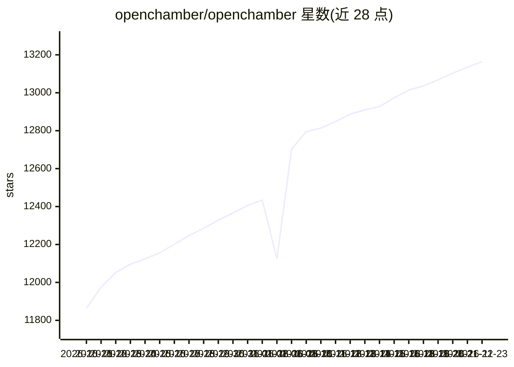

# openchamber/openchamber

⭐ 13,164 · TypeScript · MIT · 推送 2026-11-22 · [GitHub](https://github.com/openchamber/openchamber) · [官网](https://openchamber.dev/) · 组织维护

**多端运行与审查 AI 编码代理工作的开源工作区**

基于 OpenCode 构建的代理式开发工作区，用于在桌面、Web/PWA、VS Code 和移动端运行并审查 AI 编码工作。核心机制包括：Session Goals 让代理在每轮后自检并持续工作直至达成目标或受限；Multi-run 将同一任务发给最多五个模型并可用 Fusion 合并结果；Changes Walkthrough 将大 diff 转为分步讲解；Preview 支持点选元素回传截图与浏览器错误。CLI 方式需要 Node.js 24.14+，桌面版捆绑 OpenCode CLI，项目与 OpenCode 团队无隶属关系，许可证为 MIT。

## 筛选速览

| 维度 | 判定 | 备注 |
|---|---|---|
| AI 角色 | `ai-ecosystem` | LLM/agent 周边工具 |
| 许可风险 | `permissive` | MIT |
| 部署形态 | `desktop` | 安装包/桌面程序 |
| 模型依赖 | — | README 未给出锁定关系 |
| 硬件要求 | — | 无带数字的原话,不猜 |
| 安装摩擦 | `low` | 无编译、无系统依赖或容器化 |
| 成熟度 | — | 结构信号不足 |

## 能力要点

- Session Goals 持续驱动代理直至目标完成或达到上限
- Multi-run 最多五个模型并行执行，Fusion 合并各结果
- Changes Walkthrough 将大 diff 转为 AI 引导的分步讲解
- QR 配对 Private Relay 远程访问，端到端加密可随时撤销

## 适用场景

- 在手机上查看进度、回答代理提问并审查代码改动
- 同一任务交给多个模型对比产出并择优或合并
- 按 cron 计划定时运行代理任务
- 从 GitHub issue/PR 发起会话并把失败检查回传给代理

## 场景标签

`编码 Agent` `代码审查` · 领域:编码与开发

## 证据(README 行号)

> L12: **OpenChamber is an open-source workspace for running and reviewing AI coding work on desktop, web, VS Code, and mo
> L147: OpenChamber uses OpenCode to run coding agents. We chose it because it is open source, has a solid API, and is eas

## 星数曲线

2026-10-21 11,863 → 2026-11-23 13,164（+1,301）

---
*卡片 v1 · prompt 1.4 · 生成 2026-11-22 · 置信度 high · 依据 README sha `ccef27cf6601` · [字段定义](../../DATASET.md)*
