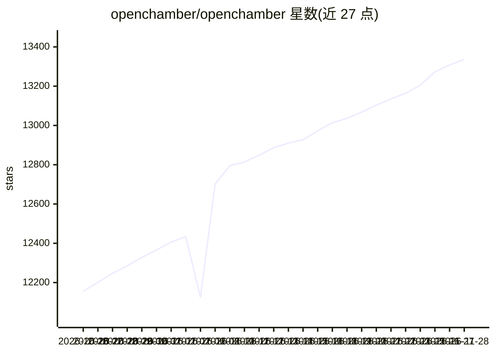

# openchamber/openchamber

⭐ 13,336 · TypeScript · MIT · 推送 2026-11-27 · [GitHub](https://github.com/openchamber/openchamber) · [官网](https://openchamber.dev/) · 组织维护

**开源工作区：跨设备运行、审查与交付 AI 编码 agent 工作**

基于 OpenCode 构建的 agentic 开发环境，覆盖桌面（macOS/Windows/Linux）、Web/PWA、VS Code、iOS/Android 与 CLI 五种使用面。核心机制包括：Session Goals 让 agent 在每轮后自动检查直至目标完成；Multi-run 将同一任务发给最多五个模型并行运行，Fusion 可合并各结果；Changes Walkthrough 将大 diff 分步讲解；Preview 可在应用内置浏览器中截图元素发给 agent；支持 GitHub issue/PR 上下文接入、定时任务、QR 码配对的端到端加密 Private Relay 远程访问。CLI 需 Node.js 24.14+；桌面版捆绑 OpenCode CLI。

## 筛选速览

| 维度 | 判定 | 备注 |
|---|---|---|
| AI 角色 | `ai-ecosystem` | LLM/agent 周边工具 |
| 许可风险 | `permissive` | MIT |
| 部署形态 | `desktop` | 安装包/桌面程序 |
| 模型依赖 | — | README 未给出锁定关系 |
| 硬件要求 | — | 无带数字的原话,不猜 |
| 安装摩擦 | `low` | 无编译、无系统依赖或容器化 |
| 成熟度 | — | 结构信号不足 |

## 能力要点

- Session Goals：自动检查每轮结果并持续驱动 agent 直到完成或受限
- Multi-run 最多五模型并行运行，Fusion 合并最优结果
- 跨设备接续：Desktop/Web/VS Code/iOS/Android 共享项目与会话
- Private Relay QR 配对端到端加密远程访问，支持 Cloudflare/Ngrok/SSH

## 适用场景

- 让编码 agent 持续自主推进带完成标准的任务
- 同一任务交给多个模型对比并择优合并
- 在手机上远程查看、审批和继续电脑上的 agent 会话
- 从 GitHub issue 发起会话并把失败的 CI 检查回传给 agent

## 场景标签

`编码 Agent` `多智能体` · 领域:Agent 开发

## 证据(README 行号)

> L12: **OpenChamber is an open-source workspace for running and reviewing AI coding work on desktop, web, VS Code, and mo
> L160: OpenChamber uses OpenCode to run coding agents. We chose it because it is open source, has a solid API, and is eas

## 星数曲线

2026-10-26 12,156 → 2026-11-28 13,336（+1,180）

---
*卡片 v1 · prompt 1.4 · 生成 2026-11-26 · 置信度 high · 依据 README sha `675bfad98be9` · [字段定义](../../DATASET.md)*
