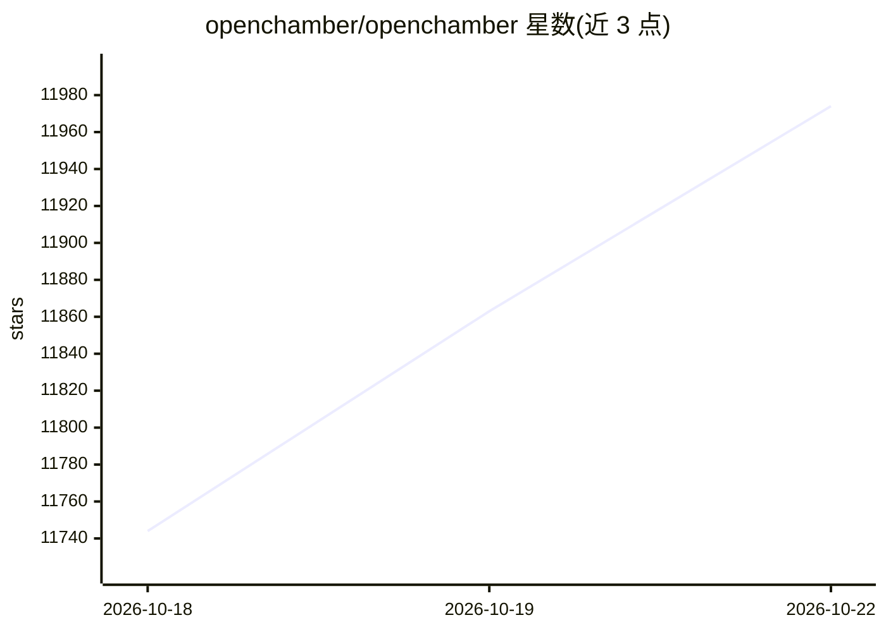

# openchamber/openchamber

⭐ 12,052 · TypeScript · MIT · 推送 2026-10-22 · [GitHub](https://github.com/openchamber/openchamber) · [官网](https://openchamber.dev/) · 组织维护

**跨桌面/网页/VS Code/移动端运行与审阅 AI 编码代理的开源工作区**

基于 OpenCode CLI 的 AI 编码代理工作区：在桌面、Web/PWA、VS Code、iOS/Android 与 CLI/服务器多种形态下启动、跟踪并审阅代理的编码工作。机制上提供 Session Goals（按目标持续运行直到完成或受阻）、Multi-run（最多五个模型并行跑同一任务并可 Fusion 合并）、Changes Walkthrough（diff 分步导览）、Preview（点选页面元素把截图与报错发给代理）、GitHub issue 到 PR 的上下文流转，以及端到端加密的 Private Relay 设备配对与定时任务。桌面版内置匹配的 OpenCode CLI；CLI/Web 需自行安装 OpenCode CLI 且要求 Node.js 24.14+。MIT 许可，与 OpenCode 团队无隶属关系。

## 筛选速览

| 维度 | 判定 | 备注 |
|---|---|---|
| AI 角色 | `ai-ecosystem` | LLM/agent 周边工具 |
| 许可风险 | `permissive` | MIT |
| 部署形态 | `desktop` | 安装包/桌面程序 |
| 模型依赖 | — | README 未给出锁定关系 |
| 硬件要求 | — | 无带数字的原话,不猜 |
| 安装摩擦 | `low` | 无编译、无系统依赖或容器化 |
| 成熟度 | — | 结构信号不足 |

## 能力要点

- Session Goals 使代理按目标持续运行，可跨设备续接
- Multi-run 让最多五个模型各在独立会话/worktree 跑同一任务，Fusion 合并结果
- Preview 点选页面元素即向代理发送截图、样式、位置与浏览器报错
- Private Relay 一次性 QR 配对提供端到端加密远程访问，无需开端口

## 适用场景

- 在桌面和手机上跟踪、审阅并合并 AI 编码代理的改动
- 同一任务并行跑多个模型并挑选/融合最优结果
- 从 GitHub issue 发起会话，把失败检查与评审意见回传代理直至合并 PR
- 定时（cron）触发代理任务并按目标自动推进

## 场景标签

`编码 Agent` `代码审查` · 领域:编码与开发

## 证据(README 行号)

> L12: **OpenChamber is an open-source workspace for running and reviewing AI coding work on desktop, web, VS Code, and mo
> L141: OpenChamber uses OpenCode to run coding agents. We chose it because it is open source, has a solid API, and is eas

## 星数曲线

2026-10-18 11,744 → 2026-10-22 11,974（+230）

---
*卡片 v1 · prompt 1.4 · 生成 2026-10-20 · 置信度 high · 依据 README sha `50ba7d4998fd` · [字段定义](../../DATASET.md)*
