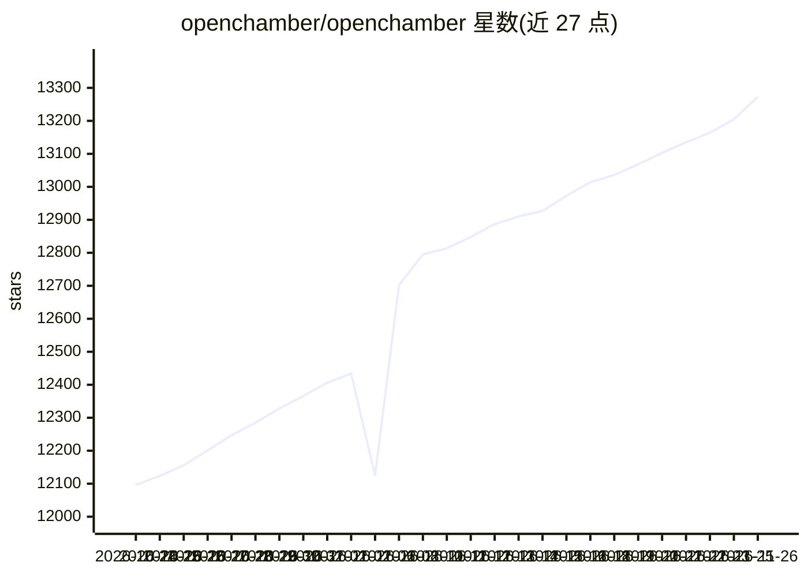

# openchamber/openchamber

⭐ 13,273 · TypeScript · MIT · 推送 2026-11-25 · [GitHub](https://github.com/openchamber/openchamber) · [官网](https://openchamber.dev/) · 组织维护

**为 AI 编码 agent 提供跨桌面/网页/移动端的工作区**

基于 OpenCode agent 的开源工作区，用于启动、跟踪、审查 AI 编码工作。核心机制包括 Session Goals（逐轮检查目标直至完成）、Multi-run（同任务最多 5 个模型并行会话并可用 Fusion 合并结果）、Changes Walkthrough（AI 引导的 diff 讲解）、Preview（点击页面元素回传截图与报错）。桌面端捆绑 OpenCode CLI；CLI/Web 需 Node.js 24.14+；面向需要跨设备管理 agent 会话的开发者。

## 筛选速览

| 维度 | 判定 | 备注 |
|---|---|---|
| AI 角色 | `ai-ecosystem` | LLM/agent 周边工具 |
| 许可风险 | `permissive` | MIT |
| 部署形态 | `desktop` | 安装包/桌面程序 |
| 模型依赖 | — | README 未给出锁定关系 |
| 硬件要求 | — | 无带数字的原话,不猜 |
| 安装摩擦 | `low` | 无编译、无系统依赖或容器化 |
| 成熟度 | — | 结构信号不足 |

## 能力要点

- Session Goals：逐轮检查结果，agent 持续工作直至达成目标或达限
- Multi-run 与 Fusion：最多 5 个模型并行会话并合并最优结果
- 跨桌面、Web/PWA、VS Code、iOS/Android 的会话延续
- Private Relay QR 配对的端到端加密远程访问

## 适用场景

- 在手机上审查和推进电脑上的 AI 编码会话
- 同一任务交给多个模型对比产出
- 按 cron 调度周期性 agent 任务

## 场景标签

`编码 Agent` · 领域:编码与开发

## 证据(README 行号)

> L12: **OpenChamber is an open-source workspace for running and reviewing AI coding work on desktop, web, VS Code, and mo
> L147: OpenChamber uses OpenCode to run coding agents. We chose it because it is open source, has a solid API, and is eas
> L149: OpenChamber handles the rest of the workflow. You can decide what to try, keep the agent on track, review the resu

## 星数曲线

2026-10-24 12,096 → 2026-11-26 13,273（+1,177）

---
*卡片 v1 · prompt 1.4 · 生成 2026-11-24 · 置信度 high · 依据 README sha `7b1ef16d6a9b` · [字段定义](../../DATASET.md)*
