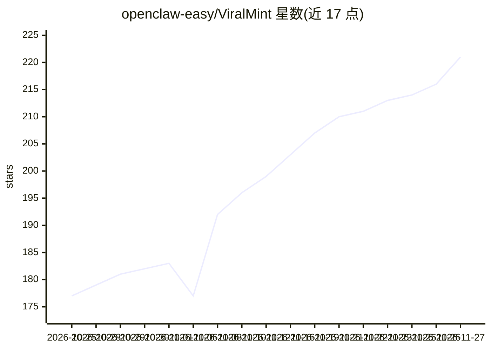

# openclaw-easy/ViralMint

⭐ 221 · Python · AGPL-3.0 · 推送 2026-11-24 · [GitHub](https://github.com/openclaw-easy/ViralMint) · [官网](https://viralmint.net) · 组织维护 · 中文 README

**本地优先的视频流水线：热点侦察、切条、字幕短视频与动效图形**

面向创作者的本地视频流水线应用：从 YouTube/TikTok/抖音侦察热点，用本地 Whisper 转写分析，在时间线上将长视频切成短片，或将脚本逐场景生成带字幕的视频，并可在无素材情况下制作动效图形。内置 22 个基于 FFmpeg+Whisper 的工具，经 MCP server 暴露 69 个工具供外部 AI agent 调用，支持 Telegram/WhatsApp/Discord/Slack 手机端对话驱动。BYOK 模式，密钥 Fernet 加密存储，无中间服务器。依赖 Python 3.11+、Node.js 18+、FFmpeg。

## 筛选速览

| 维度 | 判定 | 备注 |
|---|---|---|
| AI 角色 | `ai-native` | 本体是模型或模型工具 |
| 许可风险 | `viral` | AGPL-3.0 |
| 部署形态 | `desktop` | 安装包/桌面程序 |
| 模型依赖 | local-ok | 支持本地模型 |
| 硬件要求 | — | 无带数字的原话,不猜 |
| 安装摩擦 | `medium` | 含编译或系统依赖之一 |
| 成熟度 | — | 结构信号不足 |

## 能力要点

- 五个专用 agent（Planner/Scout/Download/Analyzer/Generator）由流式 AI 聊天编排
- 内置 MCP server 暴露 69 个工具，供 Claude Code/Cursor 等 agent 客户端驱动整条流水线
- yt-dlp 支持 1,800+ 站点下载；本地 Whisper 转写、Edge TTS 400+ 音色、FFmpeg 字幕渲染免费离线可用
- macOS/Windows/Linux 预编译安装包，或 PyInstaller 从源码构建桌面应用

## 适用场景

- 把长视频切成语句边界对齐、可直接发布的短片
- 从主题出发让 AI 起草脚本并逐场景生成带字幕的竖版视频
- 在手机上通过即时通讯软件下达指令并接收任务通知
- 将自己的 AI agent 通过 MCP 接入以运行视频生产流程

## 场景标签

`视频生成` `语音合成` `图像生成` · 领域:内容生成

## 证据(README 行号)

> L7: **Scout trends → clip long videos → build captioned shorts scene by scene → design motion graphics → polish with 22 
> L40: |🤖 **Agents, not a chat wrapper**|Purpose-built agents — Planner, Scout, Download, Analyzer and Generator — orchest
> L42: |🧩 **Drive it from your AI agent**|A built-in **MCP server** exposes 69 tools — scout, download, clip, generate, th

## 星数曲线

2026-10-25 177 → 2026-11-27 221（+44）

---
*卡片 v1 · prompt 1.4 · 生成 2026-11-26 · 置信度 high · 依据 README sha `9a8d610afd7d` · [字段定义](../../DATASET.md)*
