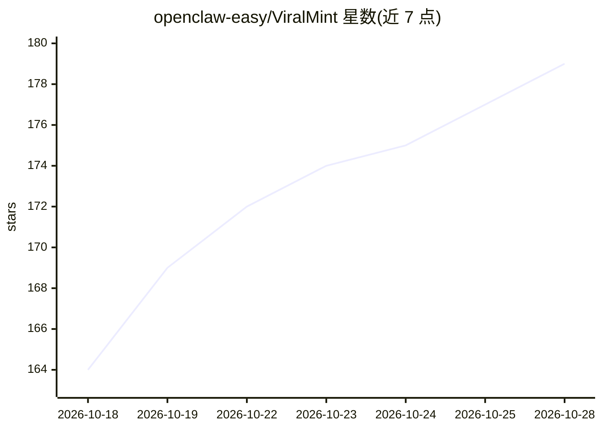

# openclaw-easy/ViralMint

⭐ 179 · Python · AGPL-3.0 · 推送 2026-10-24 · [GitHub](https://github.com/openclaw-easy/ViralMint) · [官网](https://viralmint.net) · 组织维护 · 中文 README

**本地优先的开源视频生产流水线：选题、剪辑、生成短视频**

面向内容创作者的自托管视频工具链：跨 YouTube/TikTok/抖音发现趋势、本地 Whisper 转录分析、时间线剪辑长视频为短视频、由脚本生成配字幕的素材成片、制作动效图形，内置 22 种编辑工具（多为 FFmpeg+Whisper 本地运行）。AI 部分采用 BYOK 模式，支持 Anthropic/OpenAI/OpenRouter 及任意 OpenAI 兼容服务器（Ollama、LM Studio、vLLM），密钥本地 Fernet 加密存储；提供 MCP 服务器（69 个工具）供 Claude Code、Cursor 等客户端调用，并支持 Telegram/WhatsApp/Discord/Slack 远程对话。AGPL-3.0 许可，无遥测。

## 筛选速览

| 维度 | 判定 | 备注 |
|---|---|---|
| AI 角色 | `ai-native` | 本体是模型或模型工具 |
| 许可风险 | `viral` | AGPL-3.0 |
| 部署形态 | `desktop` | 安装包/桌面程序 |
| 模型依赖 | local-ok | 支持本地模型 |
| 硬件要求 | — | 无带数字的原话,不猜 |
| 安装摩擦 | `medium` | 含编译或系统依赖之一 |
| 成熟度 | — | 结构信号不足 |

## 能力要点

- 本地优先：SQLite、本地 Whisper、本地 FFmpeg，数据不离开本机
- BYOK：密钥 Fernet 加密（AES-128-CBC+HMAC），直连 provider，无中间服务器
- 内置 MCP 服务器暴露 69 个工具，可被 Claude Code/Codex/Cursor 等驱动
- 22 个内置编辑工具多数纯 FFmpeg+Whisper 本地运行，无需 API key

## 适用场景

- 把长视频剪成可发布的短视频，由 AI 提议高光片段
- 从脚本一键生成带字幕、配音、配乐的成品 MP4
- 跨平台挖掘热门趋势视频并做 AI 分析
- 通过 Claude Code 或手机聊天软件远程指挥整个视频流水线

## 场景标签

`视频生成` · 领域:内容生成

## 证据(README 行号)

> L30: > Find trending videos across YouTube, TikTok and Douyin, transcribe and analyze them with local Whisper, cut long 
> L38: |🤖 **Agents, not a chat wrapper**|Purpose-built agents — Planner, Scout, Download, Analyzer and Generator — orchest
> L152: |AI chat, scripting, analysis|**Anthropic** · **OpenAI** · **OpenRouter** · any **OpenAI-compatible** server|conso

## 星数曲线

2026-10-18 164 → 2026-10-28 179（+15）

---
*卡片 v1 · prompt 1.4 · 生成 2026-10-22 · 置信度 high · 依据 README sha `9c2761868492` · [字段定义](../../DATASET.md)*
