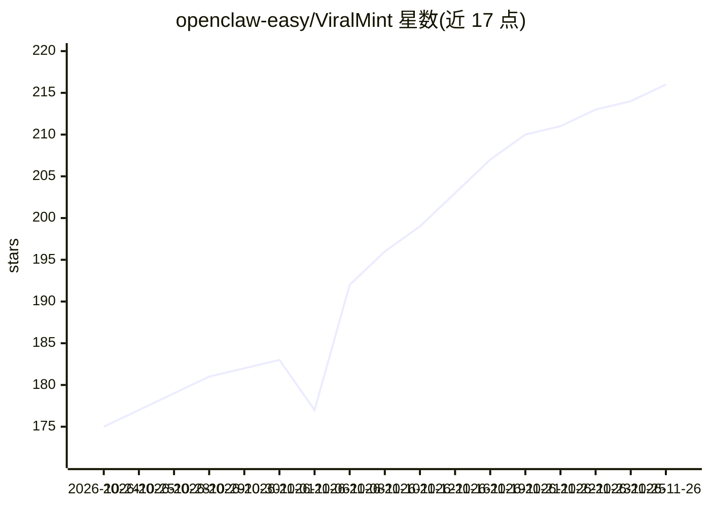

# openclaw-easy/ViralMint

⭐ 216 · Python · AGPL-3.0 · 推送 2026-11-24 · [GitHub](https://github.com/openclaw-easy/ViralMint) · [官网](https://viralmint.net) · 个人维护 · 中文 README

**开源本地视频流水线：选题、切片、生成带字幕短视频**

面向内容创作者的本地视频流水线应用：跨 YouTube/TikTok/抖音做趋势发现，用本地 Whisper 转录，在时间线上把长视频剪成短片，按场景把脚本转成带字幕视频，或生成动态图形，内置 22 个基于 FFmpeg/Whisper 的本地工具。AI 能力通过 BYOK 接入（Anthropic/OpenAI/OpenRouter 或任意 OpenAI 兼容服务器），密钥 Fernet 加密存储；无 API key 时下载、转录、配音、字幕等功能可离线运行。经 git clone 运行或 Releases 预编译安装，并可经 MCP 暴露 69 个工具供外部 agent 驱动。

## 筛选速览

| 维度 | 判定 | 备注 |
|---|---|---|
| AI 角色 | `ai-enhanced` | 去掉 AI 部分产品仍成立 |
| 许可风险 | `viral` | AGPL-3.0 |
| 部署形态 | `desktop` | 安装包/桌面程序 |
| 模型依赖 | local-ok | 支持本地模型 |
| 硬件要求 | — | 无带数字的原话,不猜 |
| 安装摩擦 | `medium` | 含编译或系统依赖之一 |
| 成熟度 | — | 结构信号不足 |

## 能力要点

- 五个专用 agent（Planner/Scout/Download/Analyzer/Generator）由流式聊天编排
- MCP server 暴露 69 个工具，可接入 Claude Code、Cursor 等 6 种客户端
- 无 API key 路径：yt-dlp 下载 1800+ 站点、faster-whisper 转录、Edge TTS 配音
- 支持 Telegram/WhatsApp/Discord/Slack 双向对话与任务提醒

## 适用场景

- 把长视频剪成可发布的字幕短片
- 从选题、脚本到成品短视频一条流水线完成
- 在手机上通过聊天软件远程指挥视频生成任务
- 让外部 AI agent 以自然语言运行整个视频流水线

## 场景标签

`视频生成` · 领域:内容生成

## 证据(README 行号)

> L5: ### The open-source, local-first video pipeline for creators
> L38: |🤖 **Agents, not a chat wrapper**|Purpose-built agents — Planner, Scout, Download, Analyzer and Generator — orchest
> L40: |🧩 **Drive it from your AI agent**|A built-in **MCP server** exposes 69 tools — scout, download, clip, generate, th

## 星数曲线

2026-10-24 175 → 2026-11-26 216（+41）

---
*卡片 v1 · prompt 1.4 · 生成 2026-11-25 · 置信度 high · 依据 README sha `66e66b7bb8de` · [字段定义](../../DATASET.md)*
